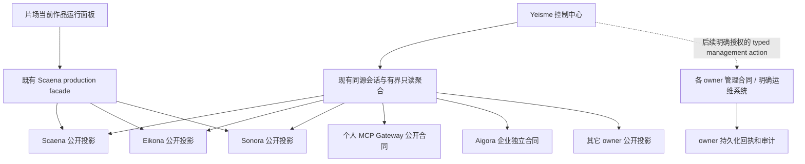

# Yeisme 控制中心：从请求报表到运行管理台

本文是设计改进提案，不替代现行 `admincn-v7.md`，不代表已批准实施、真实管理接入或生产部署。对应 OpenDesign 项目为 `yeisme-service-control-center`；v8 与 v10 均以独立提案目录呈现，原入口不覆盖。v10 的行动优先、五维服务证据和恢复任务见 `control-center-v10-readiness.md` 与对应 OpenSpec；各服务的新增公开合同仍进入各自 owner。

## 结论

保留「总览、项目、请求、资产、服务、团队」六入口及 AdminCN 组件体系，把中心从“各服务请求报表与入口目录”调整为“围绕作品和业务操作的跨服务运行管理台”。

- **控制中心**回答：什么在运行、哪里有问题、影响哪些作品、当前身份可以采取什么动作。
- **片场**回答：当前作品下一步怎么创作、选择和交付；嵌入当前项目运行面板，不嵌入整个管理后台。
- **领域服务**继续拥有任务、业务规则、权限、资产和账本；统一界面不迁移这些真源。

准入为 `split-owner`。已有正式客户端位于 `client/yeisme-control-center`，不再建立第二个控制台 owner。第一阶段复用其同源只读聚合层；后续管理写操作另行确定公开合同和授权，不能从只读聚合层暗中扩展出万能管理代理。

## 一、现状与真正的问题

### 本次证据

已通过 OpenDesign MCP 确认控制中心、漫剧开发中心和 Aigora 原型项目；通过浏览器读取控制中心总览、服务列表、Eikona 服务详情及漫剧原型。控制中心现有六入口、服务详情、配置/访问/诊断页签和约 25 项工具目录，不是完全缺少管理设计。

本地已存在正式客户端、OIDC 会话框架、只读聚合及请求可见性合同。`source-capability-matrix.md` 记录的是此前接入验证，不足以否定用户当前确认的 Scaena、Eikona、Sonora MCP 可用；也不能据此宣称控制中心自己的用户会话已获得相同权限。

本次未对真实服务执行付费生成、配置修改、重启、部署或权限变更。

### 设计问题

1. **信息优先级偏报表。** 总览首屏由大指标卡、趋势图和成功率占据；真正需要关注的任务、服务状态和继续作品入口位于下方。用户要先滚动才能开始处理问题。
2. **目录覆盖广，管理深度不清楚。** 常驻服务、本地 CLI、设计工作台混在同一长表中；“可用”“公开能力投影”不能直接回答连接、身份、业务就绪及可管理动作分别到了哪一步。
3. **已有服务详情，但缺少业务影响闭环。** 实例信息、能力、配置和诊断应该与受影响作品、任务、版本及恢复动作关联，而不是继续增加孤立页签。
4. **作品与运行事实之间的跳转不够强。** 用户应从“镜头卡住”进入对应业务操作、领域任务和具体尝试，再回到原镜头，而不是手动在三个服务间寻找 ID。
5. **片场与控制中心是入口连接，不是上下文连接。** 需要共享定位和公开投影，但不应把全局运维设置放进创作导航。
6. **设计系统来源不一致。** OpenDesign 项目元数据仍为 `designSystemId=apple`，现行客户端规范却已明确 AdminCN。它不证明现有页面样式错误，但会使下一次生成重新套用另一套规则。本提案明确沿用 AdminCN；后续接受改进时应统一 OpenDesign 设计输入与客户端规范，本轮不修改项目配置。

现有设计已经正确区分网关调用、生成任务和尝试次数，也明确标识演示数据；这些优点必须保留。

## 二、六入口不变，页面职责变得更明确

| 入口 | 第一问题 | 默认内容 | 深入内容 |
| --- | --- | --- | --- |
| 总览 | 现在什么值得处理？ | 异常/待决、核心服务、受影响作品 | 统计与成本、来源覆盖与新鲜度 |
| 项目 | 我在管理哪部作品或哪项研究？ | 项目进度、阻塞、最近结果、专业工作台 | 剧集/场景/镜头或研究对象的运行引用 |
| 请求 | 这次业务操作究竟发生了什么？ | 业务操作与关联任务 | 领域任务、网关调用、尝试、回执与恢复 |
| 资产 | 哪个版本可用于哪个用途？ | 资产、版本、来源、权利、依赖 | 预览、交接、文件传输和审阅事实 |
| 服务 | 哪个实例有什么问题、我能管理什么？ | 分组实例与多维健康 | 能力接入、配置差异、访问、事件、依赖关系 |
| 团队 | 谁在什么范围内有什么权限？ | 成员和授权来源 | 组织设置、服务账号、配额；按能力开放 |

设置保留在侧栏底部。统计、审计、通知、批准均有明确归属，不再各自扩张为主导航。个人使用优先展示作品、任务和服务；团队功能保留但不主导首页。

### 单一范围系统

顶栏只保留一个工作区切换器，承载环境、个人/组织视角、团队与项目。环境始终可见，不能只藏在弹层里。范围不等于权限，切换范围不能使未授权项目变得可见。

业务项目、代码仓库、服务实例和设计项目是不同对象。项目页默认业务作品；Gitea 仓库属于相关工程事实，OpenDesign 项目属于设计交接，不混成同一个项目模型。

## 三、总览：行动优先，统计其次

1440×900 首屏应同时看到需要处理的问题与三个核心服务，不再以大图表开场。

```text
┌ 导航 ┬ 当前工作区 / 全部项目 · 环境          搜索  通知  账号 ┐
│      │ 总览                       运行摘要 | 统计与成本      │
│      │ 接入覆盖 · 最近观察 · 有问题/未知来源                  │
│      ├─────────────────────────┬───────────────────────────┤
│      │ 现在需要处理             │ 核心服务                  │
│      │ 视频结果未知 → 查询原任务 │ Scaena：连接/授权/就绪     │
│      │ 声音用途待确认 → 查看依据 │ Eikona：连接/授权/就绪     │
│      │ 资产版本变更 → 查看影响   │ Sonora：连接/授权/就绪     │
│      ├─────────────────────────┴───────────────────────────┤
│      │ 当前作品：阶段、阻塞、最近结果、继续工作               │
│      │ 最近活动：与当前范围相关的业务变化                     │
└──────┴─────────────────────────────────────────────────────┘
```

每个待处理项提供：对象、所属作品、owner、原因或未知边界、观察时间、影响和一个明确下一步。优先级按业务阻塞、风险和时效解释，不新增无法解释的综合评分。

示例：

- Scaena MCP 连接正常，但某视频提交回包丢失：显示“结果未知”，下一步是查询原操作，不是重试生成。
- Sonora 连接正常，但一句配音的声音使用许可不足：显示业务阻塞，不把整个 Sonora 标成故障。
- Eikona 元数据可读、管理写权限未接入：展示只读，不以绿色在线推导可以改配置。

趋势、成功率、费用分布进入「统计与成本」。金额按账本、币种和时间范围展示；实际、预估、未知分开。网关费用和领域服务转述的同一费用不能相加。

## 四、服务页：从工具目录升级为分层管理

### 服务、实例、能力分开

- **产品/owner**：Eikona 是谁、负责什么。
- **实例**：在哪个环境运行哪个版本，观察来自哪里。
- **能力**：此实例公开什么合同，当前用户能否使用，最后何时验证。

常驻服务、本地工具、设计入口都可进入目录，但必须显示不同类型，不给本地工具编造延迟和在线率。

### 健康不能只有一盏灯

| 维度 | 回答 | 不能推导 |
| --- | --- | --- |
| 连接 | endpoint/协议是否可达 | 可达不等于已认证 |
| 授权 | 当前身份与范围是否被允许 | Agent MCP 凭据不等于浏览器用户身份 |
| 业务就绪 | 必需依赖、能力及资源是否满足 | 个别任务失败不等于服务宕机 |
| 管理能力 | 当前可以读取或执行哪些动作 | 有生成工具不等于支持重启/部署 |
| 观察证据 | 数据来源、观察时间及覆盖范围 | 缓存成功不等于实时健康 |

“未检查、未知、过期、未配置、无权限、能力不支持、来源不可达”分别显示。单个来源失败不遮蔽其他来源；未检查不冒充故障，缺失指标不补零。

业务管理指标优先于泛化服务器大屏：在途/排队任务、最老等待时间、worker心跳、任务失败原因、依赖可用性、可用版本和存储/配额压力。只有 owner 暴露对应指标才展示；endpoint 探测延迟不冒充生成耗时或队列等待。CPU、内存、容器和部署修订可作为已授权运维系统的补充投影，不在控制中心另造监控采集平台。

### 管理能力逐级开放

| 等级 | 体验 | 开放条件 |
| --- | --- | --- |
| 入口 | 文档、原生工具或工作台定位 | 已登记安全目标；不声称单点登录 |
| 只读 | 状态、任务、能力、脱敏配置、版本、审计 | 公开读取合同与当前范围授权 |
| 受控业务操作 | 原操作对账、允许的取消/重试/审阅 | owner 动作合同、授权、幂等、版本与回执 |
| 受控配置 | 差异预览、影响范围、校验、提交及恢复 | owner 配置版本与管理授权合同 |
| 运维生命周期 | 启停、排空、升级、回滚、容量管理 | 明确运维 owner、部署系统合同及环境级授权 |

后两项是用户管理目标的保留范围，不因首期只读而永久删除；但没有合同就显示缺口与负责 owner，不能提供远程 Shell 代替。

服务详情保留概况、任务、配置与访问、事件等工作区，可由 420px 抽屉展开全屏。默认先显示版本、健康证据、相关阻塞、受影响作品和可用动作。复杂配置先预览差异、依赖影响和基准版本，再提交；冲突保留用户输入，未知提交先查询原回执。

运维操作不得仅依据自然语言建议自动执行。生产实例、作用范围、风险、进行中任务与恢复方式应在确认前可见。缺少生命周期合同的“重启/升级”保持禁用，不能用模拟成功偷换真实可用。

### 已有合同的复用起点

这些是本次读取 owner 文档确认的源码/文档合同，不是本轮线上验收：

- Scaena 已公布 runtime descriptor、runtime readiness、项目 media-capabilities 以及项目范围控制中心 requests/summary/detail；应复用这些维度，不另造一个总布尔值。`mcp metrics` 是 operator-only CLI，不是现成浏览器/MCP公共监控接口。
- Eikona 已有认证 readiness 与控制中心 requests/summary/detail，并有独立授权的输入/附件读取合同。配置/access-key 命令属于 owner 管理能力，不意味着已存在可由浏览器远程调用的等价动作。
- Sonora 已有控制中心 AudioJob 只读交接；`sonora service start/status/stop/restart` 文档描述的是 managed loopback 进程生命周期，不能把它画成已经可用的远程服务器重启API。
- 各 owner 历史正文未保存时保留 `not_recorded`；不能为补齐管理报表而读取私有worker payload或重新生成历史内容。

## 五、请求：业务操作到执行证据的一条调查路径

示例链路：

```text
作品 / 第01集 / 镜头03
  └─ Scaena 生产操作
      ├─ Eikona 图像任务 → 候选资产/审阅
      ├─ Sonora 声音任务 → 音轨/权利
      └─ Scaena 镜头视频与合成 → 人工采用/交付
          └─ DriveBridge 文件回存引用
```

Aigora 网关调用仅在存在显式关联证据时附着到对应任务。没有关联记录就显示“未提供”，不根据相同名称、时间或邮箱猜测。

请求页保留三种视图：业务操作、领域任务、网关调用。每个视图有自己的统计口径，attempt 作为执行层，不合并计数。

详情提供：

- **概况**：业务位置、owner 原始标识、统一/原生状态、时间、费用来源、关联产物。
- **输入输出**：脱敏摘要、固定版本、受控内容权限状态；正文独立授权、按需读取、关闭清除。
- **执行与证据**：阶段、attempt、审阅/采用/交付的独立事实、错误、原操作恢复入口和 owner 回执。

恢复不变量：

- 回包丢失或超时后先查询原 logical operation，不自动换幂等键重投。
- 部分成功保留成功项，只处理 owner 明确允许重试的范围。
- “取消已请求”不等于 provider 已停止，也不等于免费或退款。
- SSE/通知是变化提示；重连后通过 owner snapshot 对账，不能靠事件重放触发写入。
- 业务完成、媒体生成成功、人工审阅通过与制作采用不是同一个状态。

## 六、片场如何共享管理能力

保持片场的业务阶段导航：剧本、拉片、画布、分镜、声音剪辑、资产、任务、审阅。不要把 Scaena/Eikona/Sonora 三个服务名变成一级创作导航。

### 嵌入当前作品运行面板

1. 顶栏或任务区显示紧凑运行胶囊：运行中、待决、阻塞；状态来自当前授权项目。
2. 点击打开约 420px 面板，只显示当前作品及所选剧集/镜头的运行状态、服务阻塞、费用来源、待审阅和下一动作。
3. 原因简单、权限明确的业务动作在原工作位置完成；复杂服务配置进入控制中心。
4. “在控制中心打开”携带非敏感稳定定位：owner、实例、项目、对象引用和返回位置；目标重新校验权限。
5. “返回镜头”恢复原对象和工作位置，不重复提交任务，不自行改动创作草稿。

这是同一份公开投影的两种呈现，不是两个前端分别维护任务状态。禁止把 token、签名下载 URL、正文或私密工具参数放到跳转链接。返回目标必须受允许列表约束，避免任意外链跳转。跨 origin 是否共享会话需另行验证，不因设计里可跳转就宣称 SSO。

全局团队、服务账号、集群配置、凭据和跨项目运维不出现在片场常驻面板中。管理权限不足时仍能保留创作位置并显示明确原因。

## 七、大部分项目的可视化能力地图

这是目标覆盖，不是“全部已经接入”的声明。每个项目分别记录目录已登记、合同存在、实例已部署、当前身份已授权、真实行为已验收五项事实。

| 项目/类别 | 控制中心重点展示 | 原 owner 保留 | 建议阶段 |
| --- | --- | --- | --- |
| Scaena | 制作操作、队列、镜头阻塞、采用与交付、worker就绪 | 生产图、调度、编辑修订、业务接受 | 第一闭环 |
| Eikona | 图像任务、尝试、版本、资产来源、审阅与费用 | provider、视觉任务、资产和审阅真源 | 第一闭环 |
| Sonora | 声音任务、voice cast引用、字幕、权利与局部恢复 | 声音任务、授权、音频资产 | 第一闭环 |
| 个人 MCP Gateway | 个人工具目录、连接、个人访问与调用事实 | 个人网关凭据、权限和运行状态 | 第一接入链，按实际路径 |
| Aigora | 模型/企业MCP调用、路由、配额与账本引用 | 企业身份、团队治理、渠道、企业权限 | 独立接入，不与个人网关合并 |
| DriveBridge | 空间、传输、失败恢复、交付文件引用 | 文件字节、受管范围和存储规则 | 第二阶段 |
| Auctra | 文稿修订、审稿、接受与生产交接状态 | 正文写作与 canonical revision | 第二阶段 |
| Anatomia | 拉片进度、证据覆盖、Snapshot和缺口 | 原始观察、Claim、证据与审阅 | 第二阶段 |
| Pinax | vault/索引就绪、写入门、知识引用 | Markdown、身份、索引和内容写入 | 第二阶段，按公开合同 |
| Capsa | 设备、同步积压、冲突和加密对象元数据 | 加密同步；不解密笔记正文 | 第二阶段 |
| Manju | 主体、证据索引、检索就绪与集合引用 | 主体/知识/证据权限和检索 | 第二阶段，待核验 |
| Template Registry | 模板版本、发行、依赖、安装与兼容性 | 模板内容、发行、签名/摘要及安装事实 | 第二阶段 |
| Quaestor | 研究论点、证据缺口、批准实验与备忘录 | 研究与实验状态机 | 扩展覆盖 |
| Digital Human | 当前实现公开的会话、任务、运行时及同意状态 | 数字人业务与运行时 | 扩展覆盖，先核验现行合同 |
| OpenDesign | 设计项目、设计run、产物与预览交接 | 设计生成、版本和Studio | 设计目录与设计任务投影 |
| Yeitra | 场景/机位项目入口、版本、交接状态 | 独立3D产品及其场景真源 | 上下文深链，合同可用后投影 |
| 片场/SoloCut/LayerLab | 专业工作台及固定上下文交接 | 各自创作交互与其正式 owner | 区分正式应用与设计入口 |
| Firecrawl | 采集队列、失败/限流、来源与结果引用 | 抓取执行和采集服务 | 扩展覆盖 |
| Gitea MCP | 仓库、Issue、PR、CI和发行事实引用 | 代码托管、CI与发布 | 工程关联，不冒充业务项目 |
| Blender MCP | 连接、公开工具、任务回执 | 3D执行边界与本机操作 | 本地/远程类型明确 |
| credentialctl | 配置来源、引用与就绪状态 | 密钥存取和轮换 | 仅安全状态，不显示密钥 |
| Runtime Plane | 本地 broker 与适配器状态 | 实验性受控runtime | 标记实验性，不变默认开关 |
| manju-hotlist | 榜单快照、历史、安全导出入口 | 本地工具与采集脚本 | 不新增常驻服务，不恢复Radar |
| Server Quality Assessor | 评估报告、版本和观察证据 | 评估执行与原始报告 | 只读报告入口 |
| Yeisme Dist | 版本、安装来源与兼容提醒 | 产品发行、镜像与安装 | 不自动升级或发布 |

Digital Human 的根目录摘要与当前项目 README 有差异；本提案不选择其中一份冒充当前运行证据，接入前按 owner 现行应用合同核验。其它本地项目同样不依据存在目录就宣称可管理。

## 八、架构与权限边界



- 不强迫所有领域 HTTP 请求经过个人网关或 Aigora；实际接入使用 owner 已批准合同。
- 浏览器使用同源会话，不保存 provider/admin key；服务端委托绑定 actor、audience 与范围。
- 聚合只读取允许列表中的实例，不接受浏览器提交任意管理 URL，避免 SSRF 和跨 owner 凭据转发。
- 每个 owner 独立授权；全局管理员不自动获得业务正文、私有素材或声音权利。
- 控制中心只拥有 UI 偏好、已批准的连接/范围映射、会话及有界展示投影；不复制领域状态机或账本。
- 通用日志、审计和导出只含脱敏事实、结果与证据引用，不收集原始 prompt、provider payload、签名链接或完整推理。
- 将来有管理写操作时，owner 持久化真实操作状态与回执；前端不能以 toast、本地timer或缓存变化认定成功。

## 九、视觉与交互原则

不更换已确定的 AdminCN 组件、Geist 和 Lucide；本轮用信息层级和密度改善，而不是第三次换风格。

- 左栏 256/48px、顶栏约56px；一个范围切换器，一个列表工具栏。
- 常规详情约420px、复杂配置560px，允许展开全屏；窄屏采用全屏详情，不压缩三栏。
- 主要控件文字14px、正文16px、辅助信息12px；表格行高44–48px，数字等宽。
- 风险颜色与类别颜色分开；红色不代表“未接入”，绿色不代表“全链可执行”。
- 页面必须有 loading、empty、error、unauthorized、stale、unknown 状态；禁用动作同时给出原因和负责位置。
- 支持明暗、键盘、焦点恢复、逐层Escape和减少动态效果；禁止用动画伪造实时执行。
- 1440×900 首屏看到异常与三服务状态；390px侧重查看、轻审阅和安全恢复，不承诺手机全量运维。

## 十、分阶段交付与验收

### 阶段A：设计验证，不接真实控制写

用独立 OpenDesign 提案验证五个重点视图：行动总览、服务实例、跨服务请求详情、项目运行页、片场内运行面板。其它主入口保留可解释入口。所有样例明确显示设计数据，不替换现有线上演示入口。

验证问题：用户能否不翻日志就找到阻塞作品、定位原任务、知道当前允许的动作，再回到原镜头？

### 阶段B：三服务真实只读闭环

先接 Scaena、Eikona、Sonora 当前身份的真实列表、详情、观察证据与作用域，结合实际经过的网关读取调用事实。接入缺口必须逐项验收，不以“MCP可用”或浏览器截图代替。

能力准备属于 `CONTRACT`；客户端界面属于 `FRONTEND`；owner投影属于 `BACKEND`；真实委托与往返属于显式 `INTEGRATION`。各阶段独立验收，前后端未接通时标记 `INTEGRATION_PENDING`。

### 阶段C：受控管理与更广项目

保持全部管理目标：原操作恢复、允许的取消/重试、配置预览、权限/配额视图，以及未来明确运维 owner 的启停/升级/回滚。按风险和合同逐项开放，不把生命周期控制塞进通用Shell。

其它项目先做类型清晰的目录与深链，再做只读投影，最后做受控操作。每次新增集成都要证明真实当前权限、状态来源与失败恢复。

### 核心验收场景

| 场景 | 必须看到的结果 |
| --- | --- |
| MCP正常但浏览器用户无权限 | 连接正常、用户未授权，不给假空列表/假成功 |
| 单个镜头未知，服务正常 | 业务阻塞与服务健康分离；仅查询原操作 |
| 某来源失联/数据过期 | 其它来源继续工作；缺口与观察时间可见 |
| 同名项目、不同环境 | 标识与范围隔离，不按名称合并 |
| 片场进入控制台再返回 | 原项目/镜头保持定位，不重复提交、不丢草稿 |
| 只读身份点击管理动作 | 显示缺合同/缺授权原因，不发送管理请求 |
| 任务部分成功 | 保留已完成产物，恢复仅限明确可重试部分 |
| 币种不同或费用缺失 | 分组或未知，不补零、不重复计算 |
| 资产新版本出现 | 当前采用版本不自动改变，依赖影响可见 |
| 退出登录或切换范围 | 清除旧正文/详情，迟到响应不能回填 |
| 1440与390、键盘与减少动态效果 | 关键动作可达，无横向溢出与焦点丢失 |

本地实现验证沿用 `bun run typecheck`、`bun run test`、`bun run build` 及现有浏览器脚本；执行前检查脚本范围，不运行 race。集成证据由既有 runner 生成，不把真实业务正文写入证据。设计预览通过、工程测试通过、真实接入通过与生产上线分别报告。

## 参考入口

- 现行规范：`admincn-v7.md`、`sidebar-motion.md`。
- 请求与权限合同：`request-visibility.md`、`source-capability-matrix.md`、`live-read-integration.md`。
- 片场产品真源：`../../scaena-studio/docs/product/production-center-prd.md`。
- 根跨项目交接：`../../../docs/architecture/yeisme-control-center-request-visibility.md`。
- 现有控制中心预览：`http://10.10.1.101:7456/api/projects/yeisme-service-control-center/raw/index.html`。
- 现有片场预览：`http://10.10.1.101:7456/api/projects/drama-development-center-unified/raw/index.html`。
- Scaena 合同：`../../../agent/scaena/docs/protocols/remote-service-and-mcp.md`、`../../../agent/scaena/docs/design/control-center-read-projection.md`。
- Eikona 合同：`../../../cli/eikona/docs/commands/service.md`、`../../../cli/eikona/docs/interfaces/control-center-read-projection.md`。
- Sonora 合同：`../../../cli/sonora/docs/commands/service.md`、`../../../cli/sonora/docs/protocols/control-center-read-projection.md`。

## 本次设计前检查

复用现有 `scripts/inspect-ui.mjs` 检查原 OpenDesign 演示，输出位于 `temp/integration-test-runs/visual-v7-2026-10-04T16-06-11-653Z/`。五个页面的1440px检查没有页面脚本错误或横向溢出，并留存成员Sheet、请求内容Sheet、390px请求页截图；这不是完整无障碍或真实服务验收。总览首条任务表行位于约1421px，支持“行动信息低于首屏”的设计判断。

提案正文已做 Markdown 诊断与引用文件存在性检查。未修改正式应用源码、身份配置或服务状态。

### 独立原型与本机补充验收

新版预览：`http://10.10.1.101:7456/api/projects/yeisme-service-control-center/raw/design-proposals/control-center-v8/index.html`。

OpenDesign MCP 生成完成；其环境未安装可用浏览器，远端 `verification.md` 如实记录浏览器未验证。本机复用本项目已安装的 Playwright/Chrome，调整独立验证脚本的主机地址与证据输出，并修正模态框内外同动作按钮的测试选择器歧义后完成补充验收。首次失败为测试选择器命中被模态框遮挡的背景按钮，不是界面缺少“返回项目”；失败证据保留。

通过的10组检查：1440×900关键内容首屏；异常→查询原对象→模拟回执→返回项目；服务搜索/分组/禁用管理/版本冲突；片场面板→控制中心→返回镜头；范围切换及个人/企业网关目录隔离；retryable任务的费用与禁用执行；搜索/焦点/Escape；1280、1920、390浅深主题和横向溢出。手机详情全屏、运行面板420px均有断言；无页面脚本错误。

- 成功证据：`temp/integration-test-runs/design-v8-2026-10-04T16-18-23-855Z/`，包含六件套与截图。
- 首次测试选择器失败：`temp/integration-test-runs/design-v8-2026-10-04T16-16-52-178Z/`。
- 当前原入口 `index.html` 与读取前摘要一致，仍指向既有 AdminCN v7。

这些检查只证明设计样例的交互和指定视口渲染。未执行屏幕阅读器、完整Axe/Lighthouse或真实服务授权测试；目录内部分图标是静态内联几何，正式迁入应复用现有Lucide组件。片场画面是面板嵌入示意，不是对正式片场源码的修改；27项目目录不是27服务已连接。正式实现仍需按本提案阶段门验收。
