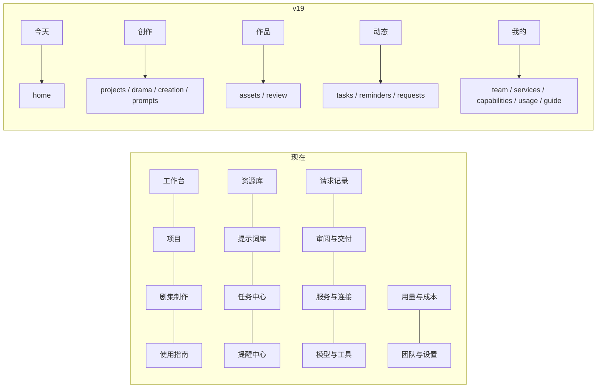
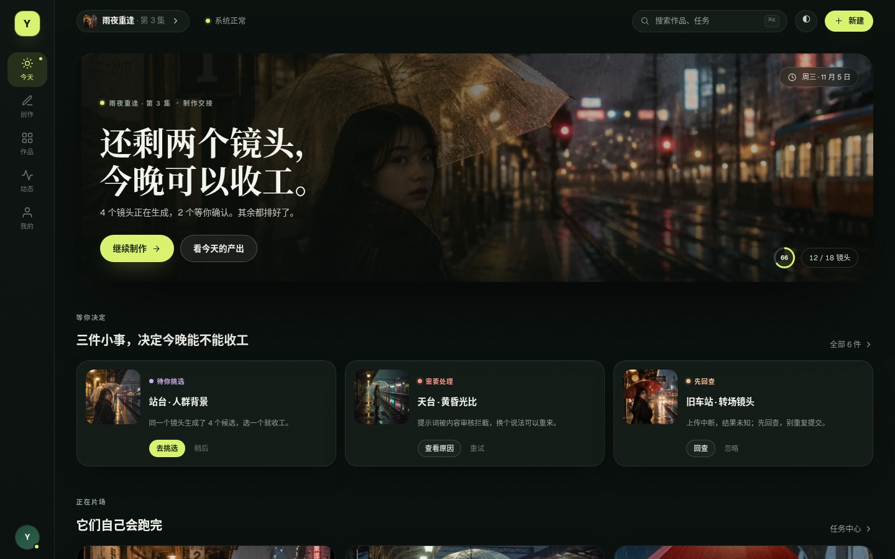
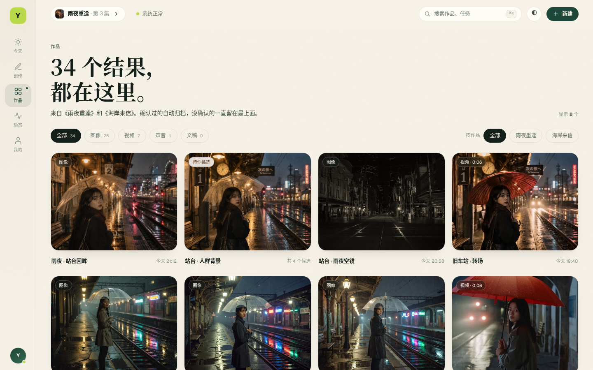
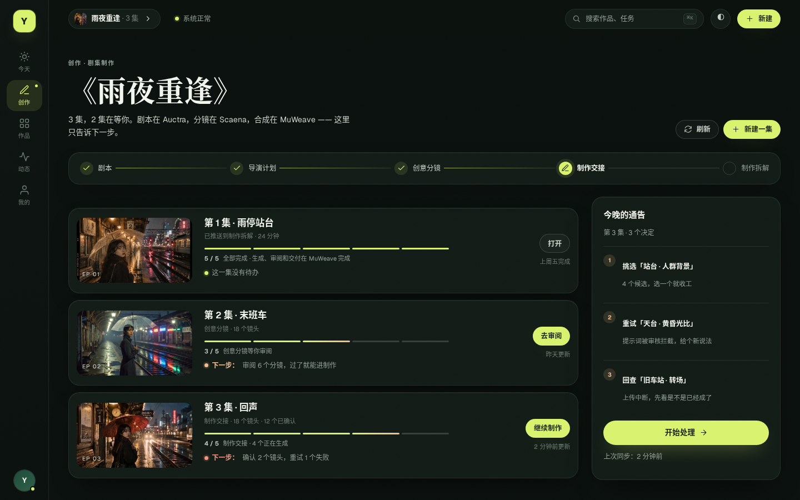
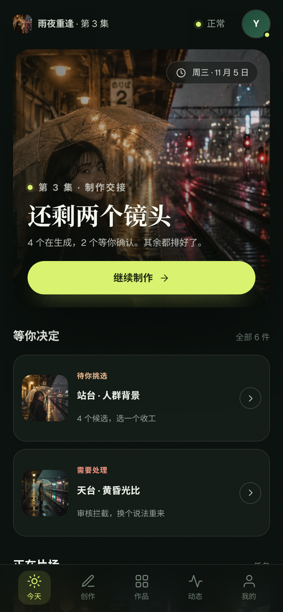

# 控制中心 C 端体验改造方案（v19 · 创作台）

- 状态：设计提案；已由 [v20](studio-v20.md) 接续并进入运行时实现
- 日期：2026-11-05
- 适用：`client/yeisme-control-center`
- 原型：`design-proposals/c-end-studio-v19/prototype/`（四屏可点，静态，无写入）
- 截图：`design-proposals/c-end-studio-v19/screenshots/`

## 0. 一句话结论

现在的控制中心回答的是「系统现在怎么样」，C 端产品要回答的是「我现在想做什么、下一步做什么」。
v19 做三件事：**把首屏从仪表盘换成一张「今天」、把 14 项导航收成 5 个入口、把 owner/状态术语换成人的话**；同时保留全部现有能力，不删页面、不改数据语义、不碰后端合同。

| | 现在（v18.1） | v19 提案 |
| --- | --- | --- |
| 首屏 | 7 张 KPI 数字卡 + 工作队列 | 一句问候 + 一张大图 + 一件要继续的事 |
| 导航 | 4 组 14 项，创作与运维混排 | 5 个入口：今天 / 创作 / 作品 / 动态 / 我的 |
| 结果 | 表格化资源库（8 个筛选控件） | 可浏览的作品集（2 组筛选 + 灯箱） |
| 状态 | 五套状态色、到处是徽标 | 一条安静状态线；坏了才升起来 |
| 文案 | owner、revision、投影、真实只读 | 谁在做、第几版、能不能读、先回查 |
| 手机 | 压扁的桌面 + 汉堡菜单 | 底部 5 tab、单列、单手可点 |

## 1. 诊断：为什么会像 SaaS

我用 fixture 环境（`preview:fixture`）在 1440 与 390 两个宽度截了现行全部 14 个页面，证据在 `screenshots/before-*.png`。问题不是「不好看」，是**叙事位置放错了**。

### 1.1 首屏在汇报，不在邀请

工作台第一屏是 7 张数字卡（待处理 15、进行中 4、待审阅 3、未知 2、来源过期 1、已观察结果 34、可读连接 6/8）。这是给值班同学看的运营看板。C 端用户打开时想的是「昨天那集生成到哪了」，不想先做一次数据巡检。

### 1.2 导航是后台目录，不是产品结构

`src/app-shell/navigation.ts` 里 14 个页面被分成「创作空间 / 生产协作 / 资源运营 / 团队」四组。用户要记住「服务与连接」在「资源运营」下，而「请求记录」属于「生产协作」。这是按组织职能分层，不是按用户意图分层。

### 1.3 技术词直接外露

首屏文案「这里只汇总 owner 返回的真实只读事实，缺失的数据保持未知」，任务行「revision rev-h1st-4-570 · 错误码 未提供 · owner 状态 失败」，服务卡「传输 / 授权 / 合同 / 内容 四维可读」。这些是内部合同语言，不是 C 端语言。用户不需要知道 owner，只需要知道「Eikona 那边读不到」。

### 1.4 表格和状态色承担了主界面

任务中心 138 行、提醒中心 14 行、资源库 34 条，全部是「行 + 状态胶囊 + 元数据」。五套状态色（成功/警告/危险/审阅/未知）同时出现，导致**没有一件事看起来更急**。C 端不是不能有列表，是列表不能是第一叙事。

### 1.5 登录页是第一印象，但它是 B 端措辞

「进入团队工作空间」「使用控制中心账号或管理员分发的访问 Key 登录」「会话 Cookie 为 HttpOnly」。安全性没错，但第一句话应该在说「继续你的创作」。

### 1.6 移动端只是缩窄，不是重排

390 宽度下仍然是同样的 7 张数字卡、同样的汉堡菜单；没有底部导航，没有拇指区，没有为单手操作排序。

### 1.7 结果没有「作品感」

资源库以大图网格展示，方向是对的；但顶部有 8 个筛选控件、告警条、以及「只读、权限、来源」的说明，视觉重心落在**控件**而不是**结果**。结果卡没有播放、没有版本、没有确认动作。

## 2. 设计方向：从「控制台」到「创作台」

### 2.1 三条原则

1. **一次只推一件事。** 首屏有且只有一个主行动（继续制作），其余事项最多 3 条「等你决定」。
2. **作品是主角。** 图像、视频、声音用大图、播放、波形、版本说话；列表退居补充。
3. **系统静音。** 连接、预算、同步时间收成一条状态线；只有真的坏了才升为可见告警。

### 2.2 语气

像一起做片子的搭档，不像值班平台：

- 「还剩两个镜头，今晚可以收工。」而不是「待处理 15 项」。
- 「它们自己会跑完。」而不是「进行中任务 4」。
- 「三件小事，决定今晚能不能收工。」而不是「工作队列 · 全部 / 待审阅 / 交接 / 阻塞 / 凭据」。

### 2.3 保留专业能力

不删能力、不删页面、不删专业视图。所有 14 个现有页面仍然可达：5 个主入口承载日常路径，**⌘K 命令面板**与「我的 → 系统」承载专业路径。技术状态仍在，只是不再占据首屏。

## 3. 信息架构：14 → 5



| v19 入口 | 收进来的现有页面 | 用户在这里做什么 |
| --- | --- | --- |
| **今天** | `home` | 继续上次；处理最多 3 个决定；看今天产出 |
| **创作** | `projects` `drama` `creation` `prompts` | 选项目 / 看每集走到哪 / 新建一集 / 复用提示词 |
| **作品** | `assets` `review` | 逛结果、预览、确认版本、待审阅 |
| **动态** | `tasks` `reminders` `requests` | 一条时间线：正在跑、失败、待回查、请求记录 |
| **我的** | `team` `services` `capabilities` `usage` `guide` | 身份与团队、系统能不能读、预算、帮助 |

规则：

- **旧路由全部保留**（`/assets` `/tasks` `/services` … 不 404），仅改变入口层级；深链和现有测试里的 `data-nav` 标识保留。
- 「系统」不是消失，是降级：顶部一枚状态胶囊 + 底部状态线；异常时琥珀色升级为可点提醒。
- 「动态」是新增的聚合页；在它落地前，`/tasks` `/reminders` `/requests` 继续独立可用。

## 4. 视觉系统 v19

### 4.1 为什么暗色优先

创作类 C 端产品（剪辑、生成、影像）大多以暗色承载作品，画面更亮、界面更退。控制中心原来只有浅色暖纸 + 深绿侧栏；v19 以**深林黑 + 暖纸浅色**双主题并行，默认跟随系统，暗色优先。

### 4.2 令牌

| 角色 | 暗色 | 浅色 | 用法 |
| --- | --- | --- | --- |
| canvas | `#0b110e` | `#f6f1e7` | 页面底 |
| surface | `#131c17` | `#fffdf7` | 卡片 |
| ink | `#f2f5ee` | `#16201a` | 主文字 |
| muted | `#93a198` | `#69766c` | 次要文字 |
| lime | `#d9f26e` | `#b9d94a` | 品牌、主行动 |
| warm | `#f0bb8f` | `#b96f43` | 人的决定、下一步 |
| danger | `#f49480` | `#b04a34` | 必须处理 |
| review | `#cbaee8` | `#77539b` | 待确认 |
| line | `rgb(236 245 236 / 9%)` | `rgb(22 32 26 / 9%)` | 分隔 |

关键约束：

- **lime 只做填充与高光，不做浅色底上的小字**（对比不足）；浅色模式的主按钮用森林绿。
- **状态色只表达状态**，不做装饰；同一屏最多出现两种强调色家族。
- 暖色（warm）专门代表「人的动作/下一步」，与红/橙告警区分。

### 4.3 字体

- 展示标题：`Noto Serif CJK SC / Songti SC` 衬线，34–52px，行高 1.16。中文衬线把「数据面板」拉开成「叙事」。
- 正文：Geist Variable（现有），14px / 1.6；元信息 11–12px。
- 数字：`tabular-nums`，用于进度、时长、金额。

### 4.4 形状与质感

- 圆角：hero 28px、卡片 20px、控件 999px（药丸）。
- 阴影：暖黑、大范围、低不透明度；禁止 1px 硬边卡片堆叠。
- 噪点：3–5% 的全局 film grain，给大面积纯色一点「印刷」感；浅色降到 2.8%。
- 图像：统一 16:9 / 4:3 裁切，底部加渐变，保证白字可读；悬停 1.04 倍缓推。

### 4.5 动效

- 入场：`rise` 0.7–0.8s，`cubic-bezier(.16,1,.3,1)`，首屏元素最多 3 个层级。
- 交互：140–240ms，`cubic-bezier(.2,.8,.2,1)`；只做位移 ≤3px 与透明度。
- Hero 画面 26s 极缓慢推近（Ken Burns），`prefers-reduced-motion` 下停止。
- 禁止循环脉冲、禁止同时移动超过两个元素。

### 4.6 无障碍

- 正文对比 ≥ 4.5:1；大标题 ≥ 3:1；lime 填充上的文字固定用深墨色。
- 焦点环 2px lime + 3px offset；暗色下在侧栏用浅色环。
- 所有可点目标 ≥ 44×44（手机 tab 高 56）。
- 每页一个 `h1`；装饰图 `alt=""`，内容图有具体描述；原型已用脚本核查无未命名控件、无横向溢出。

## 5. 关键页面

### 5.1 今天（`today.html`）



1. **Hero**：大图 + 一句人话 + 一个主按钮「继续制作」。右上日期、右下今日进度环（12/18 镜头）。
2. **等你决定**：最多 3 张卡，每张 = 缩略图 + 为什么 + 一句解释 + 主次动作。优先级用暖/红/紫点表达，不用五色徽标。
3. **正在片场**：3 张 16:10 卡，标题、进度条、百分比、预计时间；点击进任务详情。
4. **今天的产出**：4 张媒体卡，默认无操作按钮，悬停出现预览；点击开灯箱。
5. **状态线**：连接、预算、同步时间，一行小字 + 「系统和连接」入口。

状态合同（沿用现有 truth 语义）：

- 加载：媒体卡骨架，不显示 0；空：一句「今天还没有产出，去开一个」+ 新建按钮；降级：状态线变琥珀，顶部胶囊出现「2 个连接读不到」；未知：仍然显示「先回查」，不重试、不显示成功。

### 5.2 作品（`works.html`）



- 页头一句话说明总数与来源；两组筛选（类型、作品），右侧实时计数。
- 4 列画廊，卡片承担预览与「待你挑选」标记；悬停出预览/更多。
- 点击 → 灯箱（图片/视频封面 + 标题 + 规格 + 关闭），Esc 逐层关闭。
- 现有「审阅与交付」作为作品页的二级视图（待确认 / 已交付），不另做入口。
- 浅色暖纸版本与暗色版本都通过同一套令牌输出（见 `works-dark-1440.png`）。

### 5.3 创作 · 剧集（`drama.html`）



- 页头是作品名（衬线大字），一句「3 集，2 集在等你」。
- 顶部五段阶段条：剧本 → 导演计划 → 创意分镜 → 制作交接 → 制作拆解；当前段高亮。
- 每集一张横卡：封面、集号、当前阶段、5 段进度、「下一步：确认 2 个镜头，重试 1 个失败」、一个动作按钮。
- 右侧「今晚的通告」把本集待办列成 3 条，底部「开始处理」。
- Auctra/Scaena 等工具名保留在说明文字里，不在主标题和按钮里。

### 5.4 移动端（`mobile.html`）



- 顶部：作品切换 + 状态点 + 头像；无汉堡菜单。
- Hero：4:5 竖图，标题与唯一主按钮；「继续制作」占满宽度。
- 「等你决定」：两行到三行，右侧圆形进入；「正在片场」横向滑动卡片。
- 底部 5 tab（今天/创作/作品/动态/我的），当前项 lime 填充；安全区留白。
- 详情一律用底部抽屉（bottom sheet），返回手势优先；不出现桌面式右侧 Inspector。

### 5.5 尚未绘制的两屏

- **动态**：一条按「现在 / 今天 / 更早」分组的时间线，事件卡写人话（「第 3 集 · 粗剪完成」「Eikona 读不到，已保留上次结果」）；失败、未知、请求记录用同一卡片语言，技术字段收进展开区。
- **我的**：身份与团队、系统健康（连接、凭据到期、预算）、帮助与使用指南；系统异常时从这里进入详细诊断。

## 6. 文案与术语

| 现在 | v19 | 说明 |
| --- | --- | --- |
| owner | 「Eikona」「Scaena」或「图像生成」 | 前端不出现 owner |
| 授权范围 | 工作空间 / 作品 | |
| 待审阅 / waiting_review | 等你确认 | |
| 未知 / 回查 | 结果未知，先回查 | 保留「不重试」语义 |
| 来源过期 | 数据有点旧 | |
| 连接五维 / 传输·授权·合同·内容 | 能不能读 | 详情再展开五维 |
| revision | 第 N 版 | |
| 资源库 | 作品 | |
| 剧集制作 | 创作 | |
| 任务中心 / 提醒中心 / 请求记录 | 动态 | 三个列表合成时间线 |
| 进入团队工作空间 | 回到你的创作台 | 登录页 |

注意：文案只改「说法」，不改事实。未知仍是未知，未授权仍是未授权，不把失败写成成功、不把 0 写成有。

## 7. 落地路线

### P0 · 设计提案（本次，无运行时改动）

- 原型四屏 + 前后对比 + 本文档。
- 验证：原型脚本检查（筛选、灯箱、命令面板、主题切换、无控制台错误、无横向溢出、控件都有名字）。

### P1 · 外壳与「今天」（建议 3–4 天）

- `src/styles/tokens.css`：v19 令牌（保留旧变量名，新增语义层，避免全站重写）。
- `src/app-shell/AppShell.tsx`：14 项侧栏 → 5 项 rail；保留 `data-nav`、命令面板、主题、范围切换；「全部功能」进入 ⌘K / 我的。
- `src/app-shell/navigation.ts`：新增 5 个 entry，旧 page id 保留并映射到入口。
- `src/pages/home/HomePage.tsx`：按 5.1 重排，复用现有 `useScopedRead` / `useTasks` / `useNotifications`，不新增数据请求。
- `src/app/auth.tsx`：登录页第一句话与视觉。
- 验证：`bun run typecheck && bun run test && bun run build && bun run test:app`；更新 shell/home 相关断言；视觉矩阵 1440/1280/390 亮暗。
- 回滚：令牌与 shell 都是前端局部；旧 `navItems` 保留在 `navigation.legacy.ts` 一个版本周期。

### P2 · 作品（建议 2–3 天）

- `src/pages/assets/AssetsPage.tsx` + `ProjectFiles.tsx`：画廊化、两组筛选、灯箱复用现有 `MediaViewer`。
- `src/pages/review/ReviewPage.tsx`：作为作品页的「待确认」视图。
- 验证：媒体预览句柄仍按项申请；资源列表滚动/键盘/焦点回归；`tests/viewer.test.ts` 与浏览器旅程。

### P3 · 创作与动态（建议 3–4 天）

- `src/pages/drama/DramaPage.tsx` + `StageRail.tsx`：阶段条与每集下一步卡。
- `src/pages/tasks|reminders|requests`：抽出共用事件卡，新增 `/activity` 聚合时间线；旧路由保留。
- 验证：降级/未知/失败三类世界（fixture `rich|degraded|empty`）逐个截图核对；契约集成测试不回归。

### P4 · 我的、移动端与收口（建议 2–3 天）

- `src/pages/team|services|capabilities|usage` 进入「我的」二级；移动端底部 tab 与抽屉。
- 动效、降级动效、焦点顺序、对比度全量扫描。
- 验证：`test:browser-journey`、`test:visual-matrix`、`test:public-guide`、axe 扫描；`temp/integration-test-runs/` 留证据。

> 每一步只动一个层：先令牌、再外壳、再页面；不把「换皮」「换 IA」「换文案」混在一个提交里。

## 8. 风险与处理

| 风险 | 处理 |
| --- | --- |
| 浏览器旅程/视觉矩阵断言旧文案与旧导航 | P1 同提交更新断言；保留 `data-nav` 与页面 id；不删旧路由 |
| 深链失效 | `pageFromPath` 的 aliases 全部保留；新入口只是分组 |
| 浅色模式对比不足 | lime 只做填充；正文用 forest/ink；原型已覆盖亮暗两套截图 |
| 图片性能 | 复用现有短期预览句柄与 `loading="lazy"`；首屏最多 1 张大图 + 3 张缩略图 |
| 把「降噪」做成「藏错」 | 失败/未知/未授权仍然在首屏可见；只是话术变短、详情可展开 |
| 变成第二套设计系统 | 不引入新 UI 库；令牌覆盖现有 Tailwind 变量；共享组件扩展而非复制 |

## 9. 不做什么

- 不改 owner 数据语义，不新增 demo/fixture 回退，不把缺失数据补成 0 或成功。
- 不删除「服务与连接 / 模型与工具 / 用量与成本 / 团队」等专业能力，只改变入口层级。
- 不新增后端接口，不改持久化，不做写入、发布、部署。
- 不引入第二套组件库或图标库；Lucide + Geist 继续用。
- 不做全屏 TUI、不恢复旧 AdminCN/v10/OpenDesign 入口。

## 10. 验收清单

- [ ] 首屏只有一个主行动；「等你决定」≤ 3 条。
- [ ] 导航 ≤ 5 个入口；14 个旧路由全部可达且深链有效。
- [ ] 所有页面有且仅有一个 `h1`；控件有可读名称；键盘可达；焦点可见。
- [ ] 1440 / 1280 / 390；亮暗双主题；无横向溢出。
- [ ] 失败、未知、未授权在首屏仍可见，语义与现在一致。
- [ ] `prefers-reduced-motion` 下无位移动效。
- [ ] `bun run typecheck`、`bun run test`、`bun run build`、`bun run test:app` 全绿，证据写入 `temp/integration-test-runs/`。

## 11. 原型与证据

- 索引 / 前后对比：`design-proposals/c-end-studio-v19/prototype/index.html`
- 今天：`today.html`；作品：`works.html`；剧集：`drama.html`；手机：`mobile.html`
- 截图：`screenshots/`（含 `before-*` 现行版本对照、亮暗两套、手机两屏）
- 交互核查：`prototype/verify.mjs`（筛选 8→2、灯箱开关、命令面板开关、主题切换、每页控件命名/溢出检查）

本地预览：

```bash
cd client/yeisme-control-center
python3 -m http.server 4330 --bind 127.0.0.1
# 打开 http://127.0.0.1:4330/design-proposals/c-end-studio-v19/prototype/index.html
```