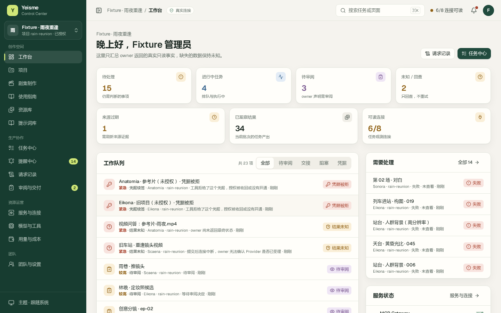
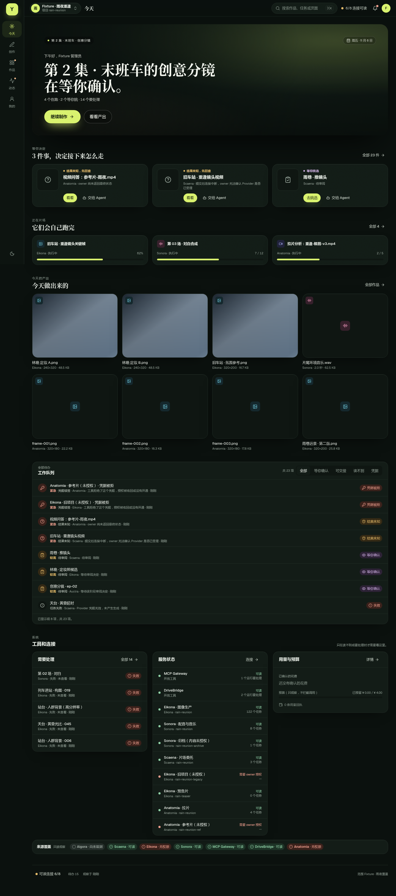
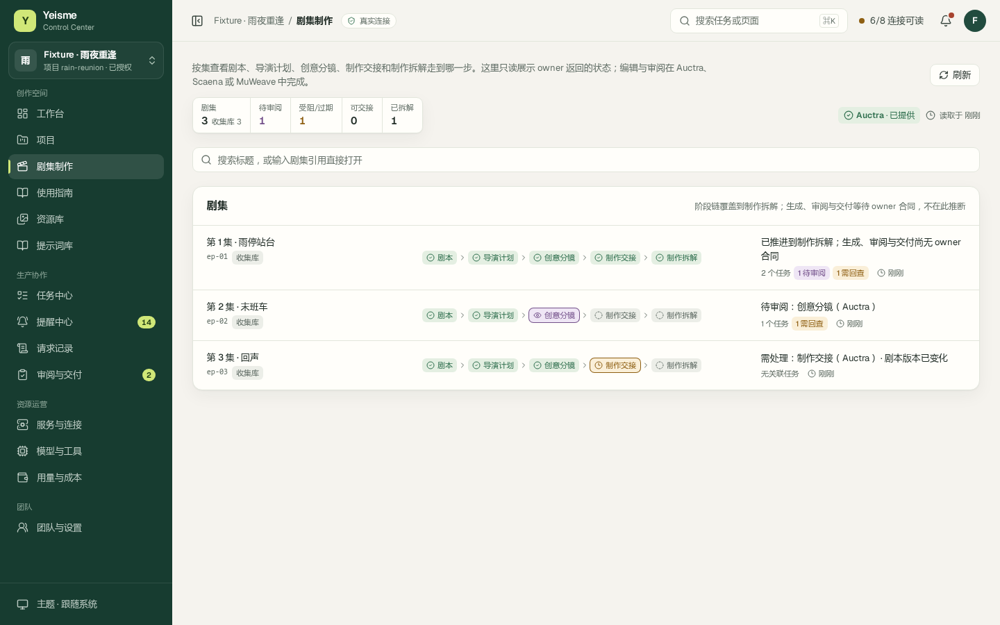
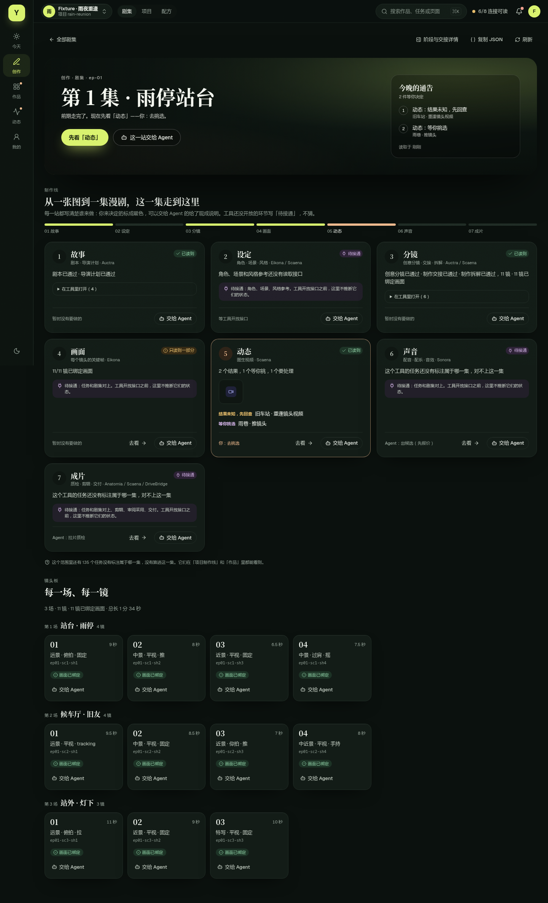
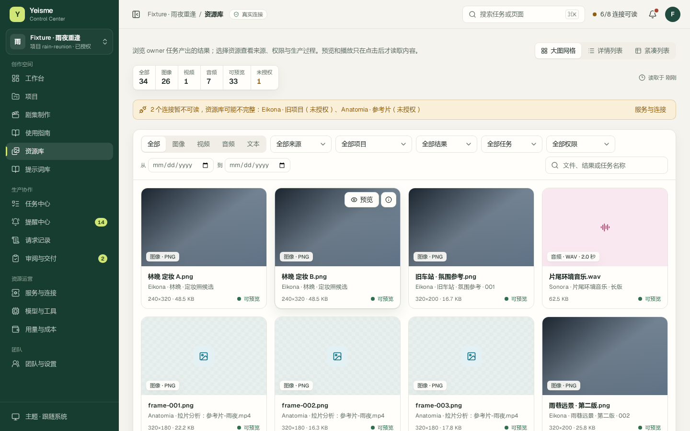
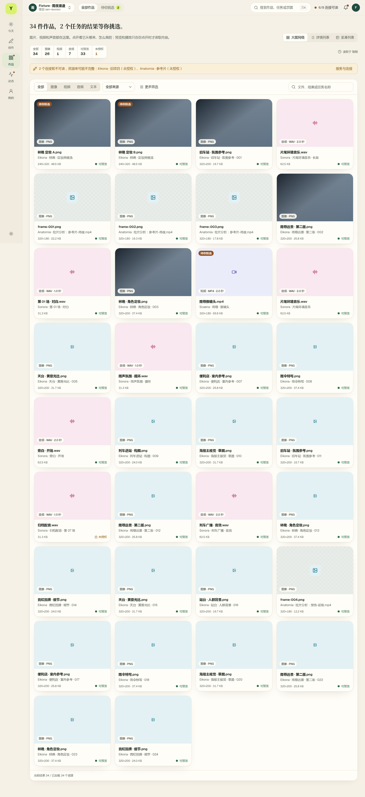
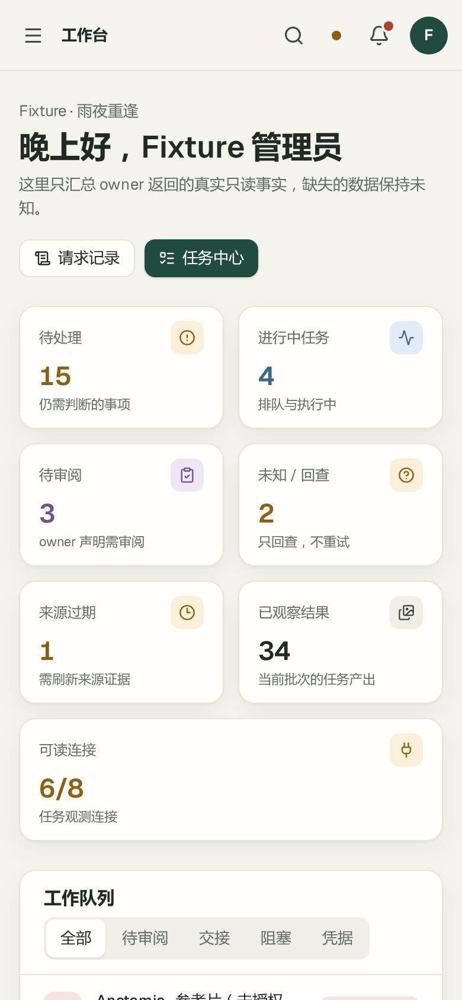
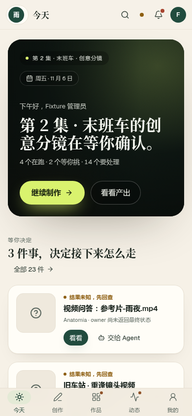
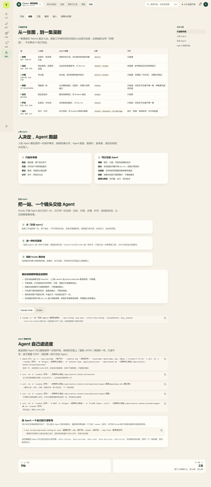

# Yeisme Studio v20 · 从控制台到创作台，从一张图到一集漫剧

- 状态：已在本地实现并用 fixture 验证（`openspec/changes/yeisme-control-center-studio-v20/`）；未提交、未部署
- 日期：2026-11-06
- 接续：[v19 C 端提案](c-end-experience-v1.md)（静态原型，未进运行时）。v20 把 v19 落进运行时，并补上全流程与人机分工
- 适用：`client/yeisme-control-center`

## 0. 一句话

现在的控制中心回答「系统现在怎么样」，创作者要的是「这一集做到哪、下一步谁来做」。v20 做三件事：

1. **把界面改成创作台。** 5 个入口；首屏是一张「今天」；作品用大图说话；系统状态收成一条线。
2. **把「图片资产 → 视频漫剧」排成一条 7 站制作线。** 一集或一个项目都能看。没接通的站如实写「待接通」。
3. **人和 Agent 读同一份制作事实，权限分开。** 人做决定，Agent 跑腿。每一站都能一键「交给 Agent」，说明里带好护栏。

控制中心仍然只**观察、决定、交接**：不编辑剧本、分镜或时间线（新的持久剪辑或漫剧开发中心客户端需要重新准入），不新增鉴权，不付费生成。

## 1. 原则

1. **一次只推一件事。** 首屏只有一个主行动；「等你决定」最多 3 条。
2. **作品是主角。** 图、视频、声音用大图、播放、版本说话；列表退到第二层。
3. **系统静音。** 连接、预算、同步时间收成一条状态线，坏了才升起来。失败、未知、未授权仍然看得见，只是话变短。
4. **人决定，Agent 跑腿。** 挑选、花钱、锁定、交付只由人做；读取、dry run 报价、出候选、回查、整理、质检可以交给 Agent。

## 2. 信息架构：14 → 5

| 入口 | 分区标签（页面 id） | 用户在这里做什么 |
| --- | --- | --- |
| **今天** | `home` | 继续上次；处理最多 3 个决定；看正在跑的和今天的产出 |
| **创作** | 剧集 `drama` · 项目 `projects` · 配方 `prompts` | 看每集或整个项目的制作线；进剧集工作室；复用提示词 |
| **作品** | 全部作品 `assets` · 待你挑选 `review` | 逛结果、预览、对比，看哪些在等你挑 |
| **动态** | 时间线 `activity` · Agent 与 MCP `agents` · 运行 `tasks` · 提醒 `reminders` · 请求 `requests` | 一条时间线看谁做了什么；看底层 MCP 遥测与活跃 Agent；需要时进专业列表 |
| **我的** | 账号与团队 `team` · MCP 网关 `mcp-gateway` · 连接 `services` · 模型与工具 `capabilities` · 用量 `usage` · 指南 `guide` | 身份、个人 MCP 网关受控运维、系统能不能读、预算、帮助与 Agent 接入 |

- **导航形态**：
  - 桌面（≥1024）用 88px 图标 rail，手机和平板用底部 5 个 tab，不再有汉堡菜单。
  - 分区标签在主区顶部，不吸顶。
- **兼容**：
  - 旧路由、别名、命令面板全部保留，深链不失效。
  - `creation`（批量生成）仍只从项目页进入。

## 3. 视觉系统 v20

| 角色 | 暗色「片场夜」 | 亮色「暖纸」 | 用法 |
| --- | --- | --- | --- |
| canvas | `#0b110e` | `#f6f1e7` | 页面底 |
| panel | `#131c17` | `#fffdf7` | 卡片与表面 |
| ink | `#eef3ec` | `#17211b` | 主文字 |
| lime | `#d9f26e` | `#d9f26e`（只做填充） | 品牌、暗色主行动 |
| primary | lime | 森林绿 `#214b3e` | 主按钮 |
| warm | `#f0bb8f` | `#8f5228`（在 canvas 与 panel 上对比 ≥ 4.5:1） | 「人的下一步」 |
| 状态色 | 沿用 | 沿用（对比度测试锁定） | 只表达状态 |

- **规则**：
  - lime 只做填充，不做浅底小字。
  - 暖色只代表人的动作。
  - 同一屏最多两种强调色家族。
- **字形**：
  - 展示标题用中文衬线（Noto Serif CJK SC / 思源宋体 / 宋体），正文 Geist，数字 tabular。
  - 只用系统字体栈，不打包字体。
- **形状与质感**：
  - hero 28px、卡片 20px、控件药丸。
  - 暖黑大范围低不透明度阴影。
  - 3–5% 胶片颗粒，亮色 2.8%。
  - 媒体统一裁切，底部渐变，悬停缓推。
- **动效**：
  - 入场 `rise` 0.6s；交互 140–240ms，只做 ≤3px 位移和透明度。
  - 减少动态效果时全部停用。
- **无障碍**：
  - 状态文字在 soft 背景上 ≥ 4.5:1。
  - 焦点环清楚，触控 ≥ 44px。
  - 每页一个 h1，列表页 h1 视觉隐藏。
  - 沿用浏览器旅程的 axe 门（亮暗、桌面与 390）。

## 4. 制作线：从一张图到一集漫剧（7 站）

| # | 站 | 人决定 | Agent 能跑 | 归属工具 | 控制中心读什么 | 今天 |
| --- | --- | --- | --- | --- | --- | --- |
| 1 | 故事 `story` | 定剧本、批导演计划 | 读剧本和计划，列出问题 | Auctra | 创作流 `screenplay`、`director_plan` | 已接通 |
| 2 | 设定 `look` | 锁定角色、场景、风格 | 出定妆和场景参考（dry run） | Eikona 视觉记忆 / Scaena 角色圣经 | 参考绑定接口：`needs_contract` | **待接通** |
| 3 | 分镜 `board` | 审分镜 | 读分镜，核对拆解与剧本版本 | Auctra → Scaena | `creative_storyboard`、`production_handoff`、`production_breakdown` 与 outline | 已接通 |
| 4 | 画面 `frames` | 每镜挑一张 | 出关键帧候选：先 dry run 报价，人确认后再提交 | Eikona | 匹配到的 Eikona 任务与图片；镜头上「画面已绑定」 | 已接通 |
| 5 | 动态 `motion` | 挑动态版本 | 图生视频预览（在 Scaena 侧发起） | Scaena | 匹配到的 Scaena 视频任务与结果 | 只观察 |
| 6 | 声音 `sound` | 定音色、听台词 | 试听配音和配乐（dry run） | Sonora | 匹配到的 Sonora 任务与音频 | 只观察 |
| 7 | 成片 `cut` | 审片、交付 | 拉片质检；在 Scaena 侧导出草稿 | Scaena / Anatomia / DriveBridge | Anatomia 拉片任务；剪辑、审阅采用、交付：`needs_contract` | 部分 |

### 4.1 两种范围

- **一集**：
  - 按 Auctra 与 Scaena 的剧集引用精确匹配任务，进剧集工作室（`#/drama?studio=<集引用>`）。
  - 目前只有 Scaena 的任务带剧集引用（服务端只为 Scaena 保留 `episode_ref`）。Eikona、Sonora 的任务对不上某一集时，画面站和声音站如实写「待接通 · 任务和剧集对上」（`episode_link_missing`），不算成 0。
  - 这一集里没标集的任务数单独给出（`unassigned_tasks`）。
- **一个项目**：范围内全部任务。真实环境目前没有任务带剧集引用、Auctra 也未绑定，项目范围让制作线今天就能用。
- **同一份结构**：`GET /production?scope=<范围>&episode_ref=<集引用>` 读一集，不带 `episode_ref` 读整个项目。

### 4.2 站点状态

| 状态 | 意思 | 界面说法 |
| --- | --- | --- |
| `observed` | 读到了，有数据 | 显示计数与结果 |
| `partial` | 读到了一部分，或部分来源读不到 | 「只读到一部分」 |
| `empty` | 来源可读，确实还没有 | 「还没有」 |
| `unconnected` | 合同存在，但这个范围没配置或没绑定 | 「未连接」 |
| `needs_contract` | owner 还没有这个环节的读取合同 | 「待接通」 |
| `unavailable` | 读了但读不到 | 「读不到」 |

缺失不写成 0，不写成成功。

### 4.3 剧集工作室

自上而下：

1. 集名（衬线大字）和真实封面。封面取本集最新的图片结果；没有就用排版封面，不拿演示图冒充。
2. 7 站制作线。
3. 「今晚的通告」：本集最多 3 个决定。
4. 镜头板：按场分组，展示景别、角度、运镜、时长、「可生成」和「画面已绑定」。只给状态，不给绑定本身。
5. 各站结果胶片条，点开进查看器。
6. 「交给 Agent」与「复制 JSON」。

## 5. 人和 Agent

### 5.1 同一份事实

- 制作线由一个纯函数 `buildProductionLine()` 构建，schema 为 `yeisme.production_line.v1`。
- 页面用它渲染；只读接口 `GET /api/control-center/v1/production` 也用它。
- 人看到的和 Agent 读到的是同一种结构，页面上「复制 JSON」就是那一份。

### 5.2 交给 Agent

- 每个站点、镜头、待办和任务都能生成一份 `yeisme.agent_brief.v1`，内容：
  - **目标**：一句人话。
  - **上下文**：项目、集、场、镜、来源版本等安全引用，沿用 `launch_context.v1`。
  - **步骤**：只读命令（Auctra / Scaena CLI），或指南里录过的 MCP 调用。
  - **护栏**：
    - 动作名先查再用。
    - 花钱只 dry run，等人确认。
    - 未知只回查。
    - 不写地址和密钥。
  - **验收**：做到什么算完成。
  - **回到哪里**：控制中心里看结果的深链。
- **三种复制形式**：「说给 Agent」中文说明；Claude Code / Codex 命令（`--strict-mcp-config` 范式）；JSON。
- 控制中心不代 Agent 执行任何一步。

### 5.3 Agent 怎么读

- **用访问 Key 读**：
  - Agent 用自己的账号和访问 Key 登录一次：`POST /api/control-center/v1/auth/personal`，请求体 `{ "username", "key" }`，要带 `Origin`。Key 从 0600 文件读，不进命令行和 shell 历史。
  - 拿到会话 cookie 后，`GET /session` 看能读的范围（`scopes[].id`）和退出用的 `csrf`。
  - 然后带 `?scope=` 读 `/production`、`/work-queue`、`/drama/episodes`。读不需要 CSRF；写一律不交给 Agent。
  - 用完 `POST /auth/logout`（带 `Origin` 与 `X-CSRF-Token`），删掉 cookie 文件。
  - 完整命令在指南「流程 · Agent 读制作线」，只用占位符，不写地址和密钥。
- **不放大 owner 读取**：
  - `/production` 的结果按会话、纪元、范围、剧集缓存 15 秒，Agent 轮询不会每次都读 owner 任务。
  - 剧集详情与列表沿用 drama 服务自己的缓存。合同集成检查验证缓存命中时 owner 请求数为 0。
- **会话没有个人任务连接时**：任务四站写「读不到 · 这个会话没有个人任务连接」（`personal_connection_required`），故事站和分镜站照常读。
- **审计归属**：审计会记在这个账号名下，建议给 Agent 单独建只读（viewer）账号。账号由管理员用 `personal-config user <配置文件> add <用户名> viewer <显示名> --key-file <新密钥文件>` 建；本变更不建账号，也不新增 Agent 专用鉴权。
- **浏览器 Agent**：可以靠稳定钩子读页面，包括 `data-station`、`data-episode`、`data-shot`、`data-decision`、`data-brief`。状态都在 URL 里，每页一个 h1，控件都有名字。

### 5.4 动态里的归属

- **请求**：只用 owner 的类型字段 `actor_type`。`human` 写「人」，`service` 写「服务」，`unknown` 写「未知」。
- **任务**：只有自由文本 `actor`，原样引用为「xxx（未标类型）」，不归类。
  - 例外：某条请求用 `task_ref` 指明了这个任务时，任务沿用那条请求的类型。这是按 owner 给的引用对齐，不是推断。
- **「Agent」**：今天没有任何 owner 合同能标出「这是 Agent 发起的」，所以时间线不会出现「Agent」标签。
  - 要显示它，需要 owner 在请求的 `actor_type` 或任务观察里加上类型字段，属于 owner 合同的后续工作。
  - 控制中心不从名字里猜。

## 6. 场景矩阵

成熟度只按证据标注：

- **exploratory**：能走通一部分，关键站待接通。
- **first-support**：真实 owner 已有可观察结果，控制中心能完整呈现。
- **mature**：真实回读、审阅和交付闭环都有证据。目前没有场景达到。

| id | 场景 | 目标用户 | 要完成的事 | 产物 | 人的关口 | 证据 | 交接 | 验证命令 | 成熟度 |
| --- | --- | --- | --- | --- | --- | --- | --- | --- | --- |
| S1 | 单张图片资产（封面、海报、插画） | 个人创作者 | 快速得到一张能用的图 | 图片候选 → 选定 | 挑选；付费确认 | 作品页、任务详情、生成批次回执 | Eikona MCP；共享项目「批量生成」 | `bun run test:browser-journey`（资源、查看器） | first-support |
| S2 | 角色与风格设定集 | 漫剧主创 | 角色前后一致 | 定妆图组、场景与风格参考 | 锁定角色和风格 | 设定站（待接通）；作品页按项目归档 | Eikona 参考图与视觉记忆（离线）；参考绑定合同待接通 | `tests/production-line.test.ts`（设定站 `needs_contract`） | exploratory |
| S3 | 图生短片（单镜 4–5 秒） | 创作者 | 让一张图动起来 | 视频片段 | 付费确认；挑版本 | 动态站、作品页视频 | Scaena MCP（控制中心视频批次仍被拒） | `tests/production-line.test.ts`（动态站） | exploratory |
| S4 | 配音与配乐试听 | 创作者 | 定声音 | 音频 | 定音色；付费确认 | 声音站、作品页音频、浮动播放器 | Sonora MCP（`voice.audition`） | `bun run test:browser-journey`（音频连续播放） | first-support |
| S5 | 漫剧单集（7 站） | 漫剧主创 | 做完一集 | 剧本、分镜、关键帧、动态、声音、成片草稿 | 审分镜、挑画面与动态、审片 | 剧集工作室 | Auctra → Scaena → Eikona / Sonora → Scaena 导出 | `bun run test:contract-integration`（`/production`） | exploratory（成片站剪辑与交付待接通） |
| S6 | 多集连载 | 工作室 | 管每集进度 | 每集一条制作线 | 同 S5 | 剧集横卡、今天 hero | 同 S5 | `bun run test:browser-journey`（剧集列表） | exploratory |
| S7 | Agent 夜间跑候选，人早上挑 | 创作者与 Agent | 起床就能挑 | 候选与报价 | 早上挑选；付费确认 | 今天「等你决定」、动态时间线 | 交给 Agent 说明（dry run） | `tests/agent-brief.test.ts` | exploratory |
| S8 | 拉片学习与成片质检 | 创作者 | 学镜头、查问题 | 拆镜帧、问答 | 判断 | 成片站、作品页帧 | Anatomia MCP | `bun run test:browser-journey`（Anatomia） | first-support |

## 7. 文案

| 现在 | v20 |
| --- | --- |
| 工作台 | 今天 |
| 剧集制作 | 剧集（在「创作」里） |
| 资源库 | 作品 |
| 提示词库 | 配方 |
| 任务中心 / 提醒中心 / 请求记录 | 动态 · 运行 / 提醒 / 请求 |
| 审阅与交付 | 待你挑选 |
| 待审阅 | 等你确认 |
| owner | 工具名（Eikona、Scaena……） |
| 进入团队工作空间 | 回到你的创作台 |

只改说法，不改事实：未知仍是未知，未授权仍是未授权，不把失败写成成功、不把 0 写成有。

## 8. 落地与验证

- 实施顺序与验证命令见 `openspec/changes/yeisme-control-center-studio-v20/tasks.md`。
- 证据在 `temp/integration-test-runs/studio-v20-<时间>/`：`baseline/` 是改动前的状态与已有失败，`final/` 是本次全量验证的日志。

### 8.1 前后对比

前图是 v18.1 运行时（v19 提案时截的，`design-proposals/c-end-studio-v19/screenshots/before-*`）；后图来自 `VISUAL_LABEL=v20 bun run test:visual-matrix`，用 fixture 世界（rich），没有真实 owner 或付费调用。

| | 之前（v18.1） | 之后（v20） |
| --- | --- | --- |
| 今天 |  |  |
| 剧集 |  |  |
| 作品 |  |  |
| 手机 |  |  |

新增的两屏：

- 动态时间线：
- 指南「流程」：
