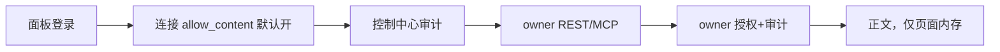

# 设计

## 决策

面板是单用户个人面板；登录即身份。内容限制改为默认放开、显式退出：`allow_content !== false` 即允许。Owner 委托读取目标成为一等配置面（`personal-config owner`），与 connect/provider 同级，仍走 CLI 结构化写入与文件锁。

## 流程

## 验证

`bun run typecheck`、`bun run test`（104 文件/979 用例）、`bun run build`、发布组件验证与 control-release 全部通过；线上发布 `control-release-2026-11-05T11-18-54-564Z` 激活，健康 200，TLS 验证通过。

## 未做

Sonora（要求 workload identity）与 Scaena（要求 scoped prompt read grant）的读取凭据需各自 owner 签发；本轮不改这两个 owner 的服务。
