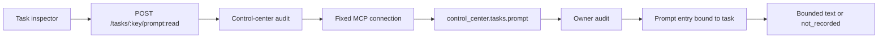

# 设计

## 入口与边界

控制中心只消费 owner 的公开 MCP 动作 `control_center.tasks.prompt`。正文、授权、任务绑定和 owner 审计仍由 Eikona 持有；控制中心只负责同源会话、CSRF、连接 `allow_content`、自己的审计行和内存展示。

## 流程

1. 任务详情从 owner 观察拿到 `prompt_capture.readable` 与 `capture_ref`。
2. 用户填写 1–200 字符用途，`POST /tasks/:task_key/prompt:read`。
3. 服务端校验个人会话、CSRF、用途和 `capture_ref`，先写 `tasks.prompt_read` 审计行。
4. `TaskConnections.promptContent` 通过固定连接调用 owner 动作，只传 project/task/capture_ref/purpose。
5. owner 再校验个人观察与正文授权、任务/项目绑定，先写 owner 审计，再返回正文或 `not_recorded`。
6. 浏览器只在当前组件状态展示正文；关闭检查器、切换 scope 或登出即清除。

## 错误与不做的事

- `content_not_authorized`：连接未开启内容或 owner 拒绝；不显示空正文冒充成功。
- `audit_unavailable`：控制中心审计写失败，零 owner 调用。
- `needs_contract` / `not_recorded`：owner 未提供合同或未留存正文，如实显示。
- 不把正文写入 URL、localStorage、服务端日志、证据目录或通知；不新增通用提示词浏览入口。

## 验证

`bun run typecheck`、`tests/task-connections.test.ts`、完整 `bun run test` 与 `bun run build`。真实 owner 读取、真实部署和用户授权另行验收。
