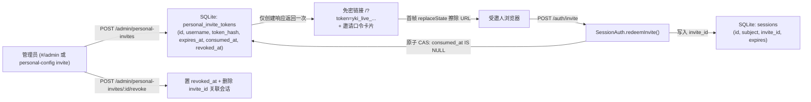

# 控制中心一次性免密邀请与口令粘贴技术设计

## 1. 数据模型与会话关系

## 2. 数据库 Schema 增量（迁移 `0014`）

1. `sessions` 表新增可空列：
   - `invite_id TEXT`（记录由哪张一次性邀请票据兑换而来；普通密码/Key 登录为 `NULL`）。
2. 新增 `personal_invite_tokens` 表：
   - `id TEXT PRIMARY KEY`（如 `inv_<random>`）
   - `username TEXT NOT NULL`（目标个人账号用户名）
   - `label TEXT NOT NULL DEFAULT ''`（用途备注，如 `邀请林舟审片`）
   - `token_hash TEXT NOT NULL UNIQUE`（`yki_live_<random>` 的 SHA-256 hex，绝不存明文）
   - `created_by TEXT NOT NULL`
   - `created_at INTEGER NOT NULL`（毫秒时间戳）
   - `expires_at INTEGER NOT NULL`（毫秒时间戳，允许范围 5 分钟至 30 天）
   - `consumed_at INTEGER`（首次兑换成功毫秒时间戳）
   - `revoked_at INTEGER`（管理员吊销毫秒时间戳）

## 3. 安全不变量

1. **原子单次消费**：使用单条 `UPDATE personal_invite_tokens SET consumed_at = ? WHERE token_hash = ? AND consumed_at IS NULL AND revoked_at IS NULL AND expires_at > ?` 检查受影响行数 `changes === 1`，在并发请求下严格保证只有一个请求能换得会话。
2. **主凭据与访客票据解耦又受控**：
   - 当会话携带 `invite_id` 时，`SessionAuth.current()` 校验目标用户仍 `enabled` 且对应 `personal_invite_tokens` 行存在且 `revoked_at IS NULL`；
   - 停用用户（`revokePersonalUser`）同时清空该用户全部会话并将该用户未消费/已消费票据置 `revoked_at`；
   - 管理员吊销单张票据仅结束 `session.invite_id === id` 的会话，不影响用户本人用 `yk_live_*` 登录的主会话。
3. **审计完备**：`auditActions` 新增 `auth.invite_redeemed`、`admin.invite_created`、`admin.invite_revoked`，记录发起人、目标用户名与 `invite_id`，零敏感字段。
