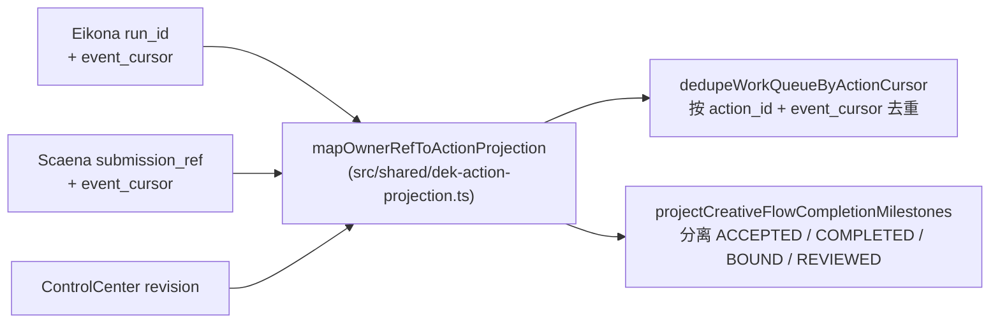

# 设计：控制中心 DEK `action_id` 统一投影

## 数据流与边界

## 诚实边界

1. 控制中心是只读投影与协作消费端，不构造第二套资产库或替代 Owner `readback_ref`。
2. `ACCEPTED`（已有稳定 ID）≠ `COMPLETED`（有权威回读）≠ `BOUND`（`binding_digest` 绑定一致）≠ `REVIEWED`（人工/审稿已记录）。
3. `preview_only=true` 时，投影固定 `preview_owner_written: false` 与 `production_ready: false`；`UNKNOWN` 状态禁止自动触发重提，只提示只读 `reconcile`。
