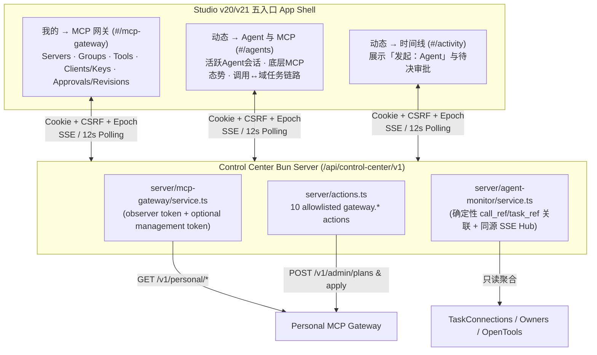

## Context

Yeisme Control Center 已落地 Studio v20/v21 的五入口 App Shell（今天 / 创作 / 作品 / 动态 / 我的）、亮暗双套视觉令牌、三态右侧 Inspector、列表翻页与 `ActionService`（Preview → Confirm → Receipt）。本设计在不增加第 6 个顶层入口、不引入任何演示回退的前提下，将个人 MCP Gateway 管理与跨项目 Agent 监控自然融入「我的」与「动态」两大入口。

## Architecture & Data Flow

## Key Design Decisions

1. **五入口信息架构零膨胀**：
   - `#/mcp-gateway` 归属 `me`（「我的」，管理连接、工具与权限的地方）；`#/agents` 归属 `activity`（「动态」，看正在跑什么和谁做了什么的地方）。
   - 桌面宽屏（≥1280px）采用主列表 + 右侧可停靠 Inspector；移动端（390px）自动折叠为底部胶囊导航 + 响应式卡片 + 底部拖动 Sheet。
2. **双凭据槽位与最小权限**：
   - `open_tools.gateway.credential_ref` 保持只读观察；`open_tools.gateway.management_credential_ref` 独立配置管理密钥并进入 `credentialStatuses`（槽位 `open_tool:gateway:management`）。
   - 未配置管理密钥或 `viewer` 登录时，`#/mcp-gateway` 顶部明确显示「当前为只读观察模式」，所有客户端预设复制和遥测查看照常工作，写按钮置灰并给出配置指引。
3. **Preview → Confirm → Receipt 对接 Gateway Plan/Apply**：
   - 10 项动作（`gateway.backend.enable|disable|exposure.patch`、`gateway.group.profile.upsert`、`gateway.tools.refresh`、`gateway.runtime.reload`、`gateway.client.mode.set`、`gateway.approval.decide`、`gateway.token.issue|revoke`、`gateway.config.rollback`）全部先经 Gateway `/v1/admin/plans` 生成真实 Diff 和 `plan_digest`，确认时再调 `/v1/admin/plans/{id}/apply`；遇到 `409 revision_conflict` 刷新基线提示重确认；超时未知置为 `unknown`，严禁重试按钮。
4. **同源 SSE + 12 秒有界轮询**：
   - 前端仅在前台打开 `#/agents` 时建立 `/api/control-center/v1/agent-monitor/stream?scope=` EventSource；断线、404 或页面隐藏时平滑切换为 12 秒轮询，配合 `ChangeClock` 丢弃迟到旧响应。
5. **确定性跨源关联**：
   - 仅当领域 `TaskSnapshot.origin_refs.gateway_call_ref`、请求 `id`/`trace_ref` 或操作引用与 Gateway `call_ref` 精确相等时才串联展示“MCP 调用 → 下游任务”；任务 `actor_type === "agent"` 时时间线显示「发起：Agent · `<name>`」，否则严格维持「未标类型」或「未知」。
