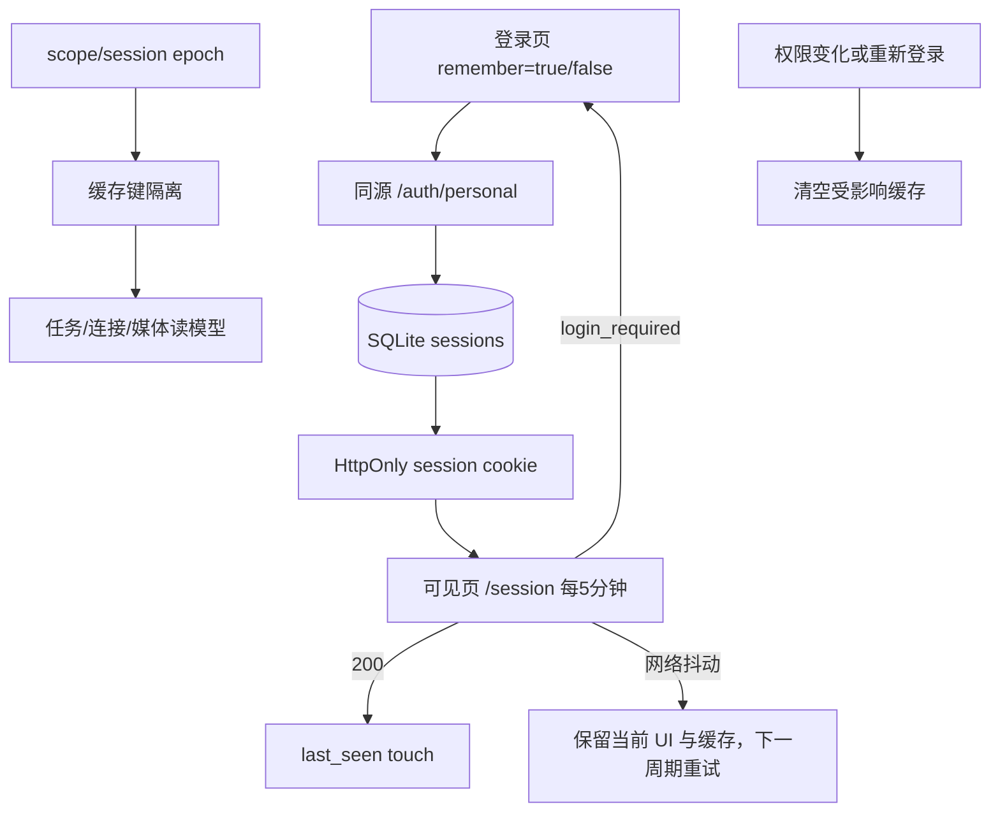

# 设计

## 范围与不变量

- Session cookie 仍为 `HttpOnly; Secure; SameSite=Lax`，前端不保存密码或访问 Key。
- 普通登录保持 12 小时绝对期限与 30 分钟空闲期限。
- `remember=true` 只扩大到 30 天绝对期限、7 天空闲期限；服务端仍检查账号启用状态、credential version、epoch 和权限绑定。
- 心跳只在页面可见时每 5 分钟发起一次，单飞；focus/visibility 恢复立即发起一次。隐藏页面不持续唤醒服务。
- 心跳遇网络错误不清空当前 session；只有 `login_required` 才转入登录页。
- 缓存 key 必须包含 scope、session epoch；logout、scope 切换、epoch 增长和 session 重新读取时清理媒体与观察缓存。

## 数据流

## 缓存策略

- owner 任务读模型继续使用现有 stale-while-revalidate 缓存；不把 HTTP 响应持久化到 localStorage。
- 会话心跳不触发 scope 数据 generation，避免每 5 分钟造成全页面重读；只更新 CSRF/epoch，epoch 变化才触发已有 reload 路径。
- 媒体 Blob/Object URL 继续只在当前会话内缓存，grant 到期、退出、scope 或 epoch 变化时清理。
- SQLite 是服务端 durable session/read ledger；迁移默认值保证旧 session 可读取为 `remembered=false`。

## 失败与安全

- cookie 缺失、会话撤销、密码/Key 轮换和绝对期限到达：返回 `login_required`，前端清除页面 session。
- 代理/网络短时错误：不调用 logout、不删除 cookie、不显示为无权限；页面保持 stale 状态并在下一次心跳重试。
- CSRF、Origin、权限与管理员门禁保持现有合同。
- 记住设备不是 refresh token，不提供无限期登录，也不绕过服务端撤销。
