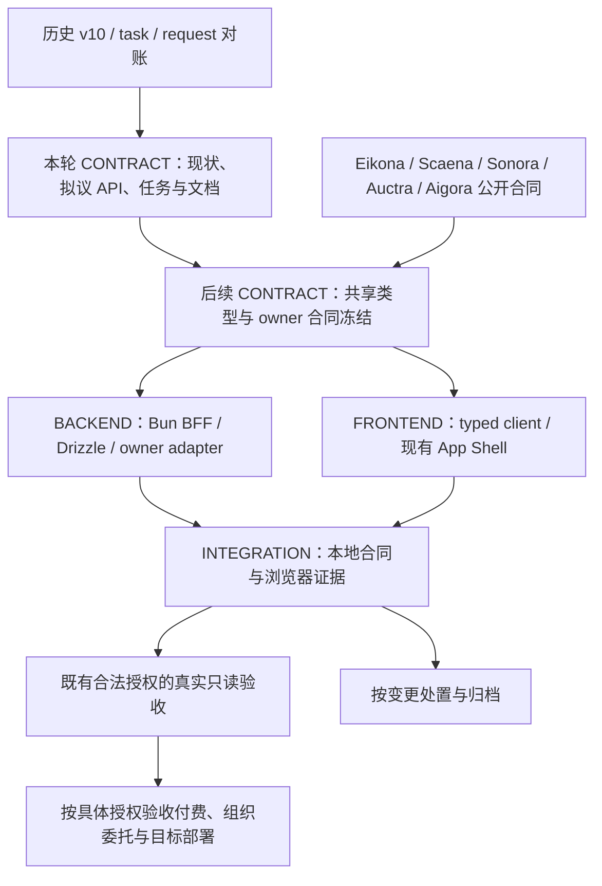

# 控制中心收尾设计

## 当前证据与目标

2026-10-21 核对 checkout `4f6ebe5fe6e986aeaa1bba1b17632c764a137ac8` 与其未提交工作树；用户提供的 `openspec list` 与实际读取一致。工作树已有组织、项目、成果目录和 Eikona 固定批次代码。本轮限定 CONTRACT：文档、接口提案与任务拆分。当前代码已存在不等于本轮验证通过，新增端点也不会因文档出现就变成已实现。

方案正文为 [completion-roadmap.md](../../../docs/completion-roadmap.md)，增量合同设计为 [frontend-api-completion.md](../../../docs/frontend-api-completion.md)，不复制第二份参数表。执行任务状态仍在各 change 的 `tasks.md`。

## 架构与依赖

浏览器只访问同源 BFF。BFF 拥有组织/项目协作记录、文件夹和成果引用，但输入正文、计划、参考绑定、原任务、内容权限、费用事实仍在 owner。`generation.input.prepare` 的确认会在 owner 保存输入，不能把它与无写 Preview 混为一谈。

## 决策

1. 沿用 React/Vite/Bun、Drizzle、Vitest、现有浏览器 runner 和 shared TypeScript 合同，不重写壳或新增业务后端产品。
2. A1 分页/detail 为本变更新增实现范围；A2 参考选择和 A3 视频固定计划由 shared-projects 原 4.3/4.2 及新增子任务实现；其余收集、流程、提醒、请求分别回原变更。completion 集成任务只验共同用户路径，不重复实现。
3. 本轮接口均标“拟议”。后续先冻结 `src/shared/collaboration.ts`、action contract 和 typed client 依赖的类型；owner 目录/quote 动作未明确时记录 `needs_contract`，禁止猜上游 URL。
4. 分页沿现有列表做兼容扩展；旧 `rows` 保留，cursor 隔离主体/项目/权限/epoch/筛选，单批次 deep link 独立读取。来源不足如实 partial/unknown，GET 的原操作观察和本地通知派生必须有界、幂等，不得转为提交。
5. 计划固定 exact input/ref/digest、binding、quote、币种和幂等键。quote 到期或 binding 变化必须显式重做 Preview；接收 unknown 只查原操作，保持 reservation，不能自动重发。
6. v10 是历史视觉方向，当前 AGENTS 是现行约束。只映射其有效行为要求到当前代码/证据；未完成的行为保留任务，不恢复旧设计、不勾选成已实现。归档先审核 delta，避免旧 UI 进入主规格。
7. 用户要求的领域 review/delivery、owner 管理、额外服务目录等未实现能力不在收尾时消失；它们以合同任务保留并指向 canonical owner。SSE 继续等待 owner event source，不伪造事件。

## 写入边界与运行模式

本轮只写本项目 docs/OpenSpec。现有 `scripts/openspec-tasks.py init|amend|append|set` 维护任务，`openspec new change` 初始化元数据；普通解释文档可编辑，不手写 YAML 或任务状态。根仓不新增产品实现，也不修改 owner 私有持久化。

后续合同阶段只写类型与规格；FRONTEND 只写页面、消费层和相应测试；BACKEND 只写 server/适配/Drizzle 与后端测试；INTEGRATION 扩展既有 runner/fixture 并产出脱敏证据。跨阶段修复回到有该路径权限的阶段，不能为过门顺手改别的项目。

前端默认保留当前 checkout 预览；后端运行或迁移在隔离 worktree，用独立端口/DB/cache/log，运行前检查是否会接入真实 owner 或付费。每个热路径单一写入者，当前不使用子 agent。

## 验收门与失败恢复

- 本轮：OpenSpec strict、文档链接/路径/命令核对和 diff whitespace 检查；可以完成本轮文档任务，不能关闭未来代码或真实门。
- 实现期：切片 Vitest 和必要类型检查；完整检查在稳定 diff 后运行一次，命令见完成方案。
- 集成：复用现有 contract/browser/shared-project runner，新增来源超时、旧 epoch、撤权、cursor、exact binding、quote、原操作恢复场景；六件套证据缺失先修 runner。
- 真实只读、组织委托、付费、部署分别有 task 和授权，fixture 或旧证据不能替代当前真实用户旅程。Scaena 无任务可证明真实空集，但不满足播放/下载门。
- 不运行 race；失败按 introduced/pre_existing/concurrent/environmental/ambiguous 归因，保留原任务/键，针对失败切片重检，不清理旧业务记录。

## 风险、兼容与未决项

owner 未发布 reference 目录/授权或 known-cost quote 时，相应代码任务为依赖等待；不阻断已可独立验收的分页工程切片。quote 金额的精确表示与已有 number 存储兼容，须在后续 CONTRACT 冻结，不能隐式汇率换算。

新增分页不应在翻页时全量轮询 owner，预算 reservation 不应因重复确认/对账重复记账。新增持久化使用 Drizzle 生成迁移，离线预演和真实应用分别验收。

本次不 archive 旧变更。通过新任务完成映射、证据回读和 delta 审查后再执行 `openspec archive <change> --yes`；superseded 历史另说明未实施项和迁移目标，禁止批量勾选清空积压。
