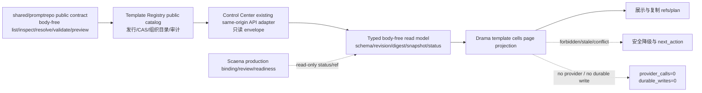

# 漫剧模板只读消费者设计

## 1. 范围与边界

这是一个 additive consumer contract，不是实现设计。Control Center 通过既有同源 `/api/control-center/v1` 适配路径消费 owner 公开的目录投影；如果当前 API 适配层无法承载该投影，后续任务必须扩展既有 adapter/client，不得另起一套 endpoint。本文中的 endpoint 名称只表示“沿用既有 API 适配路径后的待冻结动作”，不表示本轮已经新增或实现了路由。

| 能力 | canonical owner | Control Center 可做 | Control Center 禁止 |
| --- | --- | --- | --- |
| body-free list/inspect/resolve/validate/preview、schema/revision/digest/snapshot、selector fail-closed | `shared/promptrepo` | 消费已发布的类型化 projection，展示安全元数据和复制 ref | 重建 resolver、validator、digest、snapshot、selector 或 preview renderer |
| 发行、CAS、组织目录、审计 | `backend-server/template-registry` | 读取公开目录和诊断 | 读取 `.template-registry`、复制 CAS、维护 registry/cache/search |
| production binding/review/readiness | Scaena | 显示 owner readiness/ref 的只读结果 | 把 candidate cell 变成 binding、代办 review 或写 owner 状态 |
| 实验 cell 展示与复制 plan/ref | Control Center | 在页面显示、复制安全 refs/plan | 保存正文、prompt、artifact bytes、owner 状态或发起生成 |

## 2. Body-free projection 合同

建议的版本化 projection 名称为 `yeisme.drama_template_catalog.v1`（最终字段名、错误码和兼容规则须由 `shared/promptrepo` 公开合同确认）。每个 item 只包含以下信息，不包含 body、prompt、渲染文本、artifact bytes、Provider payload 或私有路径：

```text
catalog.schema_version
catalog.observed_at
catalog.revision
catalog.digest
catalog.snapshot
catalog.next_cursor
catalog.items[]
  template_ref
  schema
  version
  revision
  digest
  snapshot
  maturity: exploratory | needs_contract
  compatibility: { status, schema, consumers[], reason? }
  rights: { status, scope?, expires_at?, reason? }
  status: available | stale | blocked | unavailable | forbidden
  stale: boolean
  blockers[]
  next_action: { kind, owner, reason, ref? }
  cell: { id, label, maturity, exploratory: true, canonical: false, production: false }
```

字段约束：

1. `template_ref` 必须是 owner 产生的可复制引用；页面不通过字符串拼接构造 selector、digest 或 snapshot。
2. `schema`、`version`、`revision`、`digest`、`snapshot` 原样显示并参与兼容性检查；缺一不可时不得猜测默认值。
3. `maturity` 只能来自 owner contract。首批 cell 逐项固定唯一 maturity：`drama-30-60s-experiment` 为 `exploratory`（仅 preview/plan）；`drama-single-scene-conflict` 与 `drama-character-consistency-demo` 为 `needs_contract`，除非 owner 提供可证明的 body-free projection。`needs_contract` 不得实现、展示为可用或形成可执行 plan；不得因为出现在目录里就显示为 production-ready。
4. `compatibility` 只用于展示 owner 判定；`schema mismatch` 必须阻断复制可执行 plan，保留安全诊断和 `next_action`。
5. `rights` 只显示 owner 授予的范围、到期和原因；未知、过期或 permission denied 不得被转换成可用。
6. `status=stale` 或 `stale=true` 仍可展示 ref，但只能复制“重新获取目录/检查 snapshot”的只读 plan，不能暗示当前可执行。
7. `blockers` 和 `next_action` 必须是安全、短文本或安全 refs；不带正文、凭据、owner 私有状态和 Provider 细节。
8. `body-forbidden` 是安全合同结果，不是可通过 Control Center 重试正文读取的提示；页面显示“仅可查看引用/元数据”。

### 2.1 首批 template cells

| cell id | 展示标题 | 允许的用法 | 明确禁止 |
| --- | --- | --- | --- |
| `drama-30-60s-experiment` | 30–60 秒漫剧实验 | 复制 owner ref、schema/revision/digest/snapshot 和只读实验 plan | 不能称 canonical/production，不能直接生成或发布 |
| `drama-single-scene-conflict` | 单场景冲突 | `needs_contract`：仅展示 blocker/next_action，不展示为可用 | 在 owner 提供 body-free maturity projection 前，不实现、不复制 plan、不保存正文 |
| `drama-character-consistency-demo` | 角色一致性 demo | `needs_contract`：仅展示 blocker/next_action，不展示为可用 | 在 owner 提供 body-free maturity projection 前，不实现、不复制 plan、不保存正文 |

三项均不是 canonical template 或 production readiness；只有 30–60 秒漫剧实验的唯一 maturity 为 `exploratory`，且仅允许 preview/plan。若公共目录未返回某一 cell，页面显示 `needs_contract` 或 owner 明确的 unavailable/forbidden 诊断，不在客户端内置正文、补推 maturity 或补造目录项。

## 3. 有限 slot override

slot override 只允许 owner projection 明确列出的有限键，按 `template_ref + schema + revision + digest + snapshot` 绑定；值只在内存中用于形成待复制的只读 plan，不保存到 Control Center。客户端不得根据 slot 名称发现新槽位、接受任意 JSON 路径、合并两个模板或拼接 selector。

- 每个 cell 只能选择一份 canonical owner template ref。
- override 的数量、类型、长度和 compatibility 由 owner contract 声明；缺少声明时拒绝。
- 不允许笛卡尔组合：不会把三个 cell、多个角色、多个版本或多个 Provider binding 两两/多重展开。
- override 不等于 resolve、validate 或 preview；真正检查仍归 `shared/promptrepo` 的公开合同。`needs_contract` cell 不接受 override 或形成 plan。
- 失败时只返回 blocker/next_action 和原 ref，不返回正文，不自动替换为另一个版本。

只读预算必须显式进入 projection 或本地验证证据：`provider_calls=0`、`durable_writes=0`。任何需要付费、生成、accept、export、publish 的动作都不是本变更的 adapter/page 行为。

## 4. 安全降级矩阵

| owner 结果 | Control Center 展示 | 可复制 | next_action |
| --- | --- | --- | --- |
| registry unavailable | `unavailable`，保留上次安全 ref 仅在 owner 明示可展示时显示 | 只能复制 ref/诊断，不复制执行 plan | 等待 registry 恢复并重新 list |
| permission denied | `forbidden`，不泄露目录存在性以外的私有信息 | 否 | 请求 owner 授权或切换合法 scope |
| stale | `stale` + snapshot/revision/digest | 只复制重新同步 plan | refresh owner snapshot |
| cursor conflict | 当前页停止并标 `blocked` | 否；不得自动从第一页重放造成隐藏偏差 | 使用 owner 返回的 resume/next action 重新 list |
| schema mismatch | `blocked`，显示两侧 schema 标识 | 否 | 升级公共 contract/adapter 后再检查 |
| body forbidden | 元数据可见但正文明确不可见 | 只复制引用/元数据，不复制 body | 使用 owner 允许的 inspect/preview contract；不请求正文 |

同样的降级适用于 catalog list、单条 inspect 和后续 page projection。未知错误不被映射为 available；Control Center 不“猜测空目录”。

## 5. 适配路径与页面投影



页面 projection 只消费 `N`，不直接访问 Registry、Promptrepo cache、Scaena DB 或 Provider。复制动作复制的是 owner ref、版本化元数据和只读 plan；不把内容正文、prompt、artifact bytes 写入 localStorage、数据库、日志或 integration evidence。若需要页面缓存，只能沿用现有页面会话读取缓存规则，且本变更不新增缓存实现。

### 5.1 既有 Control Center API 适配约束

- 首选沿用 `src/shared/api/control-center-client.ts` 的 `controlCenterPrefix`、`get`、`ControlCenterApiError`、epoch/error class 映射和同源 `GET` read pattern。
- 若已有目录/能力 read adapter 能承载 owner projection，tasks 只增加 typed DTO 和 page projection；不新增平行 endpoint。
- 若尚无模板目录路由，先由 contract task 与 owner 确认现有 adapter 的扩展位置、错误 envelope、scope/epoch/cursor 绑定，再决定最小增量路由；本 change 不实现它。
- API response 必须保留 cursor、revision、snapshot、digest、stale、blockers、next_action 和安全错误 code，不能只返回 UI label。

## 6. 当前 blocker

截至本 change 读取到的公共 owner 源码/文档：`shared/promptrepo` 已有 `engine/preview.go`、`engine/discovery.go` 及 UI template API；`backend-server/template-registry` 已有 `docs/template-discovery.md`、HTTP `/v1/catalog` 与发行/组织 API。但当前 checkout 中未找到用户指定的 `docs/template-catalog-http.md`、`internal/service/template_catalog.go` 或对应稳定 HTTP catalog contract；`shared/promptrepo` 的公开 discovery projection 也尚未在本项目证据中确认包含全部 `maturity`、`rights`、`status`、`blockers`、`next_action` 字段。

因此后续 Control Center 实现必须先等待或引用 owner 的正式公开合同。不得在 Control Center 内复制这些字段的推导、读取正文、访问 registry 私有目录或伪造兼容性/rights/digest/stale 结论。这个 blocker 不阻止本 change 冻结消费边界，但阻止宣称 adapter/page 已可实现或可联调。
