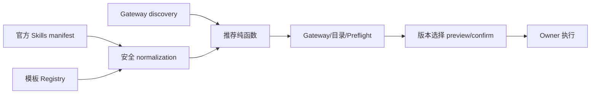

## Context
控制中心已有 Gateway 观测、工具目录和 body-free 模板投影。模板 canonical owner 与远程 manifest 合同尚未在本 checkout 证明已发布，因此本轮先实现可测试的消费合同和 UI 状态，不把 GitHub 文件当作可执行模板。

## Goals / Non-Goals
目标是连接后明确 MCP 状态、推荐 Skills/模板、固定版本并生成资产 preflight。目标不是自动生成、下载执行远程代码、重建模板 resolver，或读取私有 Registry。

## Decisions

MCP 状态拆为 transport/protocol/discovery/invocation。`tools/list` 成功只表示 discovery_ready。只读 validate 成功才表示 invocation_ready。Provider 生成、付费、写入、取消和审阅不进入自动 smoke。

Skills 与模板只保存 ref/version/revision/digest/snapshot/source metadata。manifest 中的 command、args、env、workdir、本机路径、任意 URL、凭据、正文和 Provider payload 一律拒绝。项目选择必须绑定 digest；更新只产生新 preview，不替换已固定选择。

远程 GitHub/HTTPS 源必须由 CLI/应用服务登记，限制域名、超时、大小、重定向和 schema。owner 合同未发布时状态为 `needs_contract`，UI 只展示 blocker/next action。

## Risks / Trade-offs
先做本地安全投影会推迟真实“最新模板”联调，但避免在合同缺失时伪造生产能力。缓存只保存 metadata，更新延迟由 source refresh 窗口控制；用户确认前不自动切换版本。

## Migration Plan
本轮不新增数据库迁移。selection 持久化与远程 source registry 等 owner HTTP 合同冻结后，通过 Drizzle CLI 生成加法迁移。旧项目没有 selection，UI 显示“尚未固定模板”。

## Verification
focused Vitest 覆盖 normalization、推荐、digest、body/command 拒绝、四态 MCP 和 stale/needs_contract。稳定后运行 typecheck、test、build。真实只读验证仅在 owner contract 存在时进行，不触发 Provider。
