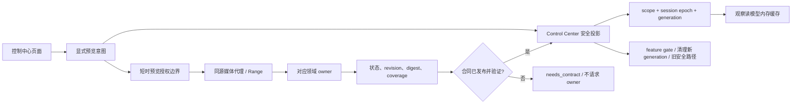
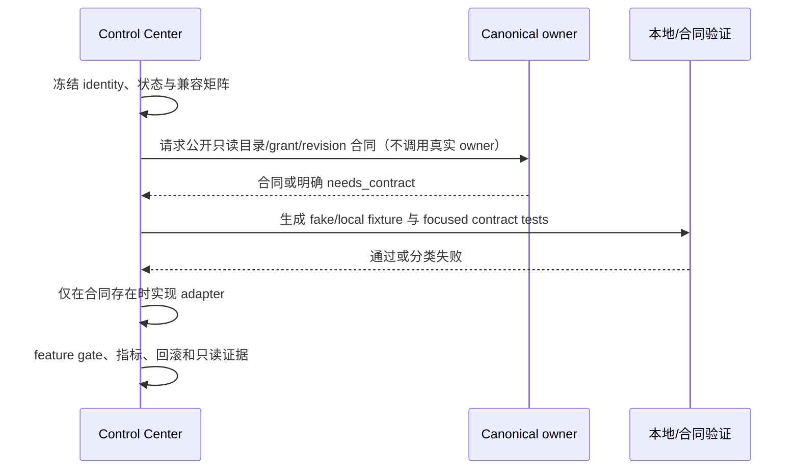

# 设计

## 设计约束与现状

本设计只描述 T0 的收敛方式。当前 checkout 可观察到：

- 观察缓存是页面内存中的 stale-while-revalidate 读模型，存在 fresh、stale、在途去重和清理行为；
- 媒体缓存是会话内 Blob/Object URL 缓存，有数量/字节上限、到期时间、迟到结果丢弃和 `URL.revokeObjectURL` 清理；
- cache identity 已经受 scope、session epoch 或 workspace generation 影响；退出、切换范围、会话重读和权限 epoch 变化会清理媒体或使读模型失效；
- 媒体访问遵守短时控制中心句柄、同源代理、`Cache-Control: no-store` 和 owner 重新授权；大媒体优先 Range，原生播放失败才回退 Blob；
- owner 的任务、内容、权利和费用不归控制中心。owner 目录、内容 grant、撤权与 revision 语义未形成一套可由本变更凭空补齐的共同合同。

以上是输入事实，不是对所有 owner 当前部署能力的保证。T0 不修改它们。

## 目标与非目标

### 目标

1. 形成一份本地可执行的缓存身份、失效、去重、容量和指标合同。
2. 形成一份只读预览的安全边界和状态投影合同。
3. 为 owner 缺口建立具名 handoff：谁发布什么，Control Center 何时才能做 adapter。
4. 以版本化、增量和 fail-closed 方式保证既有客户端/投影兼容，并给出可逆的后续落地路径。

### 非目标

不实现新缓存、不新增媒体端点、不修改 owner API、不做性能优化、不做真实 owner 读取、不部署、不付费、不改变权限，也不把 fixture 变成生产成功证据。

## 能力 ledger 的判定规则

- `fit`：Control Center 可以在本地完整负责，但只能使用已经存在的安全输入。
- `split-owner`：owner 决定真源和授权，Control Center 负责安全消费与投影；两边都必须有证据才能标记可用。
- `blocked`：目标明确但缺合同或验证，保持 `needs_contract`，不得猜测实现。
- `reject-now`：本轮明确禁止或不在 T0 范围的动作，例如 Provider、付费、写入、部署和真实授权。

每一项能力的 owner、证据、缺口和下一步以 proposal 的 ledger 为索引；后续任务不得删除条目来制造完成感。

## 方案总览



## 决策

### 1. 统一身份但不合并数据源

本地缓存条目的逻辑身份由以下维度组成：

```text
cache_identity = scope_id + session_epoch + local_generation
```

任务、请求、连接、剧集或媒体对象等业务 key 只能附加在该 identity 之后。`generation` 是本地生命周期防护，不等价于 owner revision；`session_epoch` 是会话/权限边界，不等价于内容版本。owner 的 `revision` 与 `digest` 只在 owner 明确提供时作为对象一致性条件，不可由更新时间或 URL 推导。

失效规则：

- scope 改变、登出、会话替换、epoch 增长：清理或隔离相关 read model 与全部媒体 Object URL；
- generation 改变：所有旧在途响应只能丢弃，不能写回新 identity；
- owner revision/digest 不匹配：该对象标为 stale/contract conflict，重新走明确读取或保持阻断；
- TTL 到期：允许按既有读模型策略重新读取；不能把旧媒体 Blob 当新授权；
- 缺少身份维度：拒绝入缓存，避免用“默认范围”代替未知主体。

缓存只存脱敏、可再生的派生值。禁止 durable 浏览器缓存、凭据、owner token、原始正文和未授权媒体。

### 2. 观察读模型与媒体缓存分开

观察读模型可以使用 stale-while-revalidate，但必须明确 `fresh`、`stale`、`unavailable` 和 `needs_contract`。失败响应不得冒充成功数据，也不得因为一次网络失败永久缓存拒绝；旧数据显示 stale 时应同时给出覆盖度和最近观测事实。

媒体缓存不复用观察缓存的 TTL 或错误策略：

- 只接受已授权的 Blob/Object URL，条目带 MIME、大小、过期时间和 identity；
- grant 到期、撤权、退出、范围/epoch/generation 变化时立即丢弃并 revoke；
- 迟到的授权/下载结果如果属于旧 generation，不得落入新缓存；
- 超出条目数或字节上限时按既定 LRU/最旧使用时间淘汰；
- 原生 Range 播放失败时可以在同一明确 preview 意图内回退 Blob，但不能回退到未授权 owner URL 或完整原图。

### 3. 预览先确认意图，再请求授权

列表、搜索、排序、hover、预加载和缓存命中都不能隐式触发媒体 owner 读取。用户明确点击 preview/download 后，Control Center 才能根据已有安全引用生成受控访问请求。请求至少绑定当前 scope、session epoch、对象引用和（若 owner 提供）expected revision/digest、purpose；具体 owner 字段和错误码必须等待 owner 合同。

浏览器可见内容仅是控制中心安全投影、MIME、短时句柄或同源地址，不暴露 owner 原始 URL、grant token 或秘密。服务端每次代理读取都重新确认会话、scope、权限、用途、过期和审计条件。

### 4. 合同 adapter 采用状态保真与 fail-closed

本地 projection 只映射 owner 明确返回的字段，不重写 owner `state`/`native_state`。`coverage`、`freshness`、`source_current` 是控制中心派生观察，不得被写回 owner 状态。推荐的本地结果分类为：`ready`、`stale`、`empty`、`forbidden`、`unavailable`、`needs_contract`、`expired`；这只是本地投影词表，不是未经批准的 owner 错误码。

合同版本策略：

- 以明确的 `schema_version`/projection 名称区分本地 DTO 版本；
- 只增加可忽略的元数据和状态，不删除已有安全字段或改变旧状态含义；
- revision/digest 只做 exact compare，不做隐式内容重算；
- owner 未提供必需字段、返回未知权限状态、字段类型不符或来源合同未登记时，返回 `needs_contract`，不保存、不执行、不显示为 ready；
- fixture 只能覆盖本地拒绝/映射逻辑，不能证明 owner 正向合同。

### 5. 性能合同只承诺可测的本地边界

T0 不给未测 owner 设延迟承诺。后续本地实现可记录以下脱敏指标：

| 指标 | 口径 | 不得包含 |
| --- | --- | --- |
| `cache_read_hit` / `cache_read_miss` | 同一 identity 下 fresh/stale 读取 | key 中的正文、token、URL |
| `cache_inflight_dedup` | 同一 key 合并的在途读取数 | owner payload |
| `preview_authorize_ms` | 明确 preview 意图到授权结果 | 原始响应正文 |
| `preview_first_byte_ms` | 代理/Range 首字节时间 | 媒体内容 |
| `preview_bytes` | 已传输字节数 | 文件路径、owner URL |
| `contract_blocked` | 因缺合同而阻断的次数 | owner secret 或正文 |

性能验收先在 fake/local owner 上建立基线，再按 owner handoff 做只读验证；任何基线不能替代真实 owner 合同。

## 兼容矩阵

| 维度 | 现有行为 | T0 后续允许的增量 | 禁止的变化 |
| --- | --- | --- | --- |
| 读模型 | 本地内存、stale-while-revalidate、旧 rows/状态保留 | 添加 identity、原因和指标 | 改写 owner 状态、把失败缓存成成功 |
| 媒体 | 当前会话 Blob/Object URL、短时 grant、no-store | 明确 purpose、revision/digest 和统一错误映射 | localStorage 原始媒体、永久 URL、未经授权 fallback |
| 合同 | 已有 typed DTO 与 owner 投影 | 版本化 additive adapter、显式 coverage | 猜 endpoint、猜 enum、把拟议字段宣称已发布 |
| 预览交互 | 显式 preview/download | 可访问的确认、过期重试说明 | hover/列表自动请求、Provider 调用 |
| 安全 | 同源 cookie、scope/epoch/CSRF 和 owner 权限 | 更细的审计/指标 | 复用 Agent 管理凭据、扩大权限 |

## Owner handoff 与当前缺口

| owner / 边界 | 当前缺口 | Control Center 下一步 | 完成门 |
| --- | --- | --- | --- |
| Eikona / Scaena / Sonora | 目录、preview grant、MIME/Range、撤权、revision/digest 语义未作为共同合同验证 | 各 owner 提供只读 schema、错误集合、权限和示例脱敏 fixture；Control Center 冻结 adapter | 本地合同测试 + owner 合同集成；不触发 Provider |
| DriveBridge / 媒体传输边界 | 交付/传输不等于预览授权，接收方权限和撤回语义需分开 | 明确 preview 与 delivery 不共用 action；等待传输 owner 合同 | 只读 grant/代理合同通过，写入仍独立 |
| Template Registry / Prompt repo（若提供预览资产） | 版本、digest、source coverage 和内容读取权限未验证 | 保持 `needs_contract`，只接 body-free metadata | owner 发布目录合同后再做 typed adapter |
| Control Center | 本地 cache key、TTL、容量、状态映射和回滚开关未形成单一文档 | 进入 T1 CONTRACT，再做实现和 fixture | strict OpenSpec + focused tests + diff 审查 |

## 回滚与故障处置

T0 本身无运行时改动。未来落地必须提供：

1. **禁用开关**：关闭新 cache/preview adapter 后，回到已有安全只读列表和显式 preview 路径；不把失败改写成成功。
2. **版本隔离**：新 cache key 带 generation 或 schema 版本，回滚时只清理新版本内存条目/Object URL，保留旧页面可重新读取能力。
3. **合同撤回**：owner 合同版本失效、digest 不一致或撤权时立刻映射为 `needs_contract`/`forbidden`，不自动重试未知写操作。
4. **数据安全**：不删除 owner 记录、不回滚权限、不撤销凭据、不重放 Provider 请求；若未来引入本地持久化，必须先有向后兼容读取、备份和独立迁移回滚设计，本 T0 不允许引入。
5. **证据分类**：失败记录为 `introduced`、`pre_existing`、`environmental` 或 `ambiguous`，保留请求引用和脱敏状态，不保存正文、Cookie、token 或媒体。

## T0 交付后的序列



若 owner handoff 尚未完成，序列停在 `needs_contract`，不以本地 fixture、旧归档证据或页面存在代替 owner 回答。
