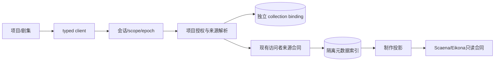

## Context
保留 React/Vite/Bun、Drizzle/SQLite 与同源 typed client。沿批准计划按隔离、基线、后端、前端、联调、快照发布推进。当前 checkout 含大量未提交依赖；单写入者继续当前目录，后台验证须独立端口/临时配置/数据库/日志，不以裸 HEAD worktree 丢弃基线。

## Goals / Non-Goals
目标为共享项目→剧集→制作线及安全真实只读验收。不重构全量 app.ts，不改变 owner 服务，不新建凭据，不执行收费动作，不改变线上项目绑定。

## Decisions

每个共享项目最多一个 Auctra 来源。保存 owner/source_scope/project_ref/revision，不保存 actor/endpoint/credential；每次读取重新检查当前访问者来源权限、tenant 和项目精确匹配。project_admin 管理绑定；共享项目可见不等于来源授权。独立 GET binding/options 与 project.collection_binding.set，通过既有 preview/confirm；confirm 重新校验 revision 与来源摘要，重复确认返回原回执，解绑立即失效。

索引/cache identity 纳入访问者、epoch、项目修订、来源指纹和有效连接；授权先于缓存。成功零条与未同步、partial、无凭据、needs_contract 分开。禁止共享来源绑定扩权 authoring。

深链使用 sharedProject，先解析 scope 再读取；无权不回退个人范围。项目制作使用真实 production 聚合而非空剧集。Gateway 严格映射版本化 runtime/checkpoints/client/snippet，不能以缺失字段补零冒充真实观测。

联调 CLI 生成临时绝对 database.path/config_file、loopback 配置、observation disabled、background off；清除 Provider 环境覆盖；只读策略阻断领域写入口。凭据仅保留既有引用，不输出。源库/源配置不打开写入、不迁移。就绪必须来自自身子进程；不输出临时密码。owner 自身审计与本地临时索引写入不冒称零写入。

## Risks / Trade-offs
来源逐访问者隔离可能重复索引，但避免创建者代权。旧 owner 未部署合同显示 needs_contract，不阻止安全本地验证，也不能声称全站完成。新表只加法，线上无自动绑定。完整生产发布须同一审核快照通过门禁与认证读回，无合法既有凭据则阻断。

## Migration Plan
Drizzle CLI 生成新增表迁移；旧项目默认无绑定。发布前对一致性 SQLite 副本验证迁移、旧表完整性及旧版本回滚兼容；只部署已有清单控制中心。冻结必要 tracked/untracked 源码逐文件摘要，排除配置、凭据、数据库、依赖和 temp；锁定依赖构建，快照变更即失效。不自动提交推送。

## Verification
实现期 focused Vitest；稳定后 typecheck/test/build/app/contract/server-boot/browser/visual/public-surface/OpenSpec strict。真实验证强制临时数据库，temp/integration-test-runs 六件套只记安全状态计数；正文、原始响应、Cookie、token 不进入证据。禁止 race 和生产压测。失败区分 introduced/pre-existing/concurrent/environment/ambiguous，不能改弱断言。
