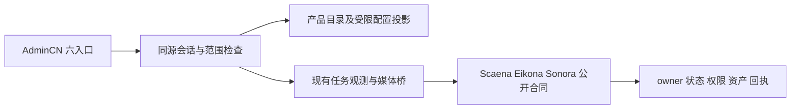

## Context
Open Design MCP 已确认主项目 yeisme-service-control-center、index.html、六入口 AdminCN v7 与能力矩阵；后续会话过期不抹除已读取证据。client/yeisme-control-center 为未初始提交的独立 Git 工作区，当前实现必须保留。configured internal origin 是本机，三个 yeisme-lan owner unit 正在运行，但没有控制中心配置与 observer 授权证明。

## Decisions
- PHASE 分离：CONTRACT 固定协议；BACKEND 和 FRONTEND 独立验收；真实联通进入 INTEGRATION。
- workspace 例外：源码全部未提交，无法在不提交的前提建立等价 worktree。单写入者留当前 checkout，测试使用临时配置、独立端口、进程及证据目录；不切分支、不提交。
- 沿用 React/Vite/Bun、AdminCN、Radix、Lucide、Vitest 和 Playwright，不引入数据库或权限平台。
- personal.username 可选；已配置时 POST /auth/personal 必须提供匹配 username 和 password。旧配置无 username 时仍允许 password-only。role 来自服务端配置，仅 admin/viewer；旧配置与 OIDC 默认为 viewer，不自动提升。
- GET /session 增加 username（可选）与 role。控制中心 admin 仍受 scope_ids、connection_ids 和 owner 凭据限制；不能获得未授权正文或触发缺合同动作。
- GET /auth/methods 增加 username_required，不公开实际账号。登录失败统一 invalid_credentials；已有节流、哈希、过期和 CSRF 保留。
- GET /services?scope=<id> 为已登录、范围绑定的配置目录；schema_version=yeisme.service_directory.v1。只返回静态产品信息及当前 scope 允许的连接 id/label/environment/project、配置开关。禁止 endpoint、credential_ref、秘密、其他范围连接。observation=not_checked，配置不等于上线。
- 动态健康和授权使用现有任务观测返回，不从静态目录猜测；断连、未授权和缺合同分别显示。取消和内容开关只是本地意愿，不增加 owner 权限。重试仍缺稳定合同，不显示可执行。
- GET /health 只证明该进程响应，不探测 owner、不公开用户、路径或秘密；不是三服务 readiness。
- 命名个人用户初始化用现有 personal-config CLI；密码通过交互或标准输入进入强哈希路径。默认拒绝覆盖已有配置；不持久化真实明文。
- 本地目录修正已退役 Yeitra；空目录 mediahub/n8n 不冒充现存产品；个人网关与企业 Aigora 保持独立。

## UI contract
复用 AppShell、DataTable、AdminPanel、PanelNotice。登录为 username/password 表单，错误清晰、提交期间禁用；服务页以产品类型/搜索/配置状态筛选，详情显示 owner 与接入缺口，不展示假绿灯。账号与设置明确角色和 owner 权限边界。390/768/1440/1920 视口、明暗、键盘/焦点、加载/空/错误均验收；不新增装饰或动画库。

## Rollout and blockers
当前 AGENTS.md 仍禁止真实部署及实际授权变更。先完成本地源代码；部署前必须解除有效冲突，取得合法 observer 和现存可验收任务。现行单元运行不证明 observer 存在。无任务时不自动生成样本；无 TLS 信任时不能把忽略证书错误作为安全交付。指定内网入口不授权修改其他服务或复用 Agent 管理 key。

## Verification
聚焦新增身份/目录测试，再执行最终类型、测试、构建与目标浏览器链路。真实接入六件套保存在 temp/integration-test-runs。失败保留，区分 introduced/pre_existing/concurrent/environment/ambiguous。无 race。

## Rollback
旧 personal 配置与 OIDC 接口兼容；新目录 GET 不修改 owner。停止控制中心不会停止 owner 或删除任务。仅回退此次源码与独立运行配置，不恢复/覆盖无关未提交成果。
