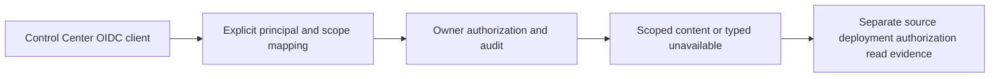

# 设计与交接

## Context

正式客户端位于 client/yeisme-control-center；OpenDesign 始终为独立演示。浏览器通过同源服务端聚合层读取 owner 固定公开操作。

## Decisions

- 身份取 issuer+subject 的显式绑定，不按姓名或邮箱合并；owner 每次再次验证授权。
- 默认近24小时，最多7天；分页与全范围汇总分离，游标绑定用户、项目及查询。
- 网关调用、生成任务、执行尝试、产出分别统计。实际上传依 upload_ref 去重，引用资产不计上传字节；无法获取字节时返回 null。
- 普通元数据不携带正文、密钥、内部提示、私有工具参数、Provider payload 或永久媒体地址。
- 内容读取是带用途的受控操作，审计失败不得先读取内容；不采集、不回填历史正文。
- 部分来源失败保留其他授权结果；来源覆盖与时间可见。

## Current implementation boundary

2026-11-03：承接 Sonora `sonora-control-center-read-projection-v1` 原 2.2–2.4，合并至本变更既有同号待办，不重复创建任务、不改变 pending 状态。Control Center 拥有 Web OIDC client、PKCE/会话、显式 principal/scope 映射、四 owner 只读联调与分层证据；Sonora 继续拥有本领域 token/scope、撤权、内容和附件授权以及先审计后读取。Control Center 登录不构成 owner 授权，跨 owner delegation 未独立准入时保持 blocked_dependency。原始注记及双向引用保留在 tasks.md。

2026-11-03 真实实例复验显示 personal viewer 的 HTTPS 登录读回通过，但当前配置没有 OIDC issuer/client。owner read 基础接口通过，Eikona/Anatomia 详情事件可读，Scaena 无任务，Sonora 返回 503；该状态进入 `partial`/`owner_unavailable`，不通过重试或 Provider 调用掩盖。

完整交付须分别验收本地实现与日常内网。未配置 OIDC 和目标 owner 委托时 fail closed；不复制测试站点 Cookie。

业务正文与附件传输需要 owner 明确的记录及授权合同。不存在的内容不从内部日志或文件系统猜取。缺口见本 owner 文档及客户端能力矩阵。

## Rollout

本地源代码和测试可先交付。日常服务部署、IdP 注册、授权与采集启用是独立操作，本次任务归属迁移没有执行这些动作。回滚使用正式客户端已有版本，不恢复旧 OpenDesign 页面；owner API 保持兼容。

