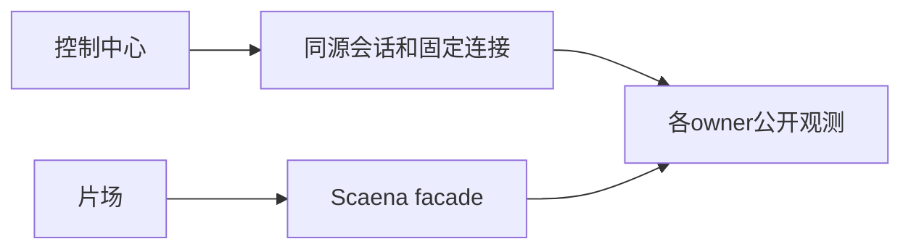

## Context
执行用户已批准的三服务+片场计划。既有源码依赖未提交工作，控制中心为未初始提交仓库，因此单写入者在当前checkout串行实施；独立临时数据和端口，不切换分支，不提交。

## Decisions
- 复用application service，不shell out、不读其他owner私有存储。
- schema_version=yeisme.task_observation.v1；locator={owner,instance_id,project,task_family,task_ref}。
- snapshot含state/native_state、stage、progress(kind,count,percent)、created_at/updated_at/observed_at、results、allowed_actions、revision与coverage。缺失值null，不虚构百分比。
- MCP动作control_center.capabilities、control_center.tasks.list/get/events/cancel；前四项不推进执行。
- 个人连接固定endpoint/project/credential_ref，当前身份与内容权限由owner再验证。
- 实时队列与固定历史查询分离，活动任务不能被24小时窗口过滤。
- 取消需要额外权限、幂等与回执；无此合同显示不可用，不模拟成功。
- 先冻结合同，再分端实现；另一端未验收时INTEGRATION_PENDING。

## Verification
本owner聚焦命令：`bun run typecheck && bun run test && bun run build`。集成六件套写temp/integration-test-runs；失败保留证据。普通测试不调用真实provider。

## Rollback
新增合同可关闭，保留旧API/MCP动作；不删除历史任务、结果与凭据，不回滚账本。部署和真实权限启用独立授权。
